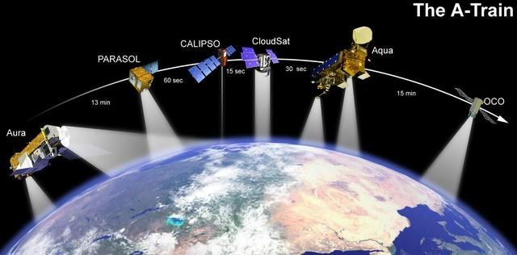

# NASA Space Apps Project Roadmap


*Illustrative image: [NASA/JPL](<https://images.nasa.gov/details/PIA03010>). This independent guide is not endorsed by NASA.*


## NASA Space Apps Challenge-এর জন্য বাংলা প্রকল্প-পরিকল্পনা

> **এই নথির উদ্দেশ্য:** একটি challenge বেছে নেওয়া থেকে শুরু করে দলগতভাবে prototype তৈরি, পরীক্ষা, presentation এবং project submission পর্যন্ত কাজকে ধাপে ভাগ করে দেওয়া।
>
> **নিয়ম সম্পর্কে সতর্কতা:** এটি NASA-র official rulebook বা কোনো নির্দিষ্ট বছরের schedule নয়। এখানে timeline, role, meeting ও checklist হলো ব্যবহারিক planning aid। বর্তমান বছরের Participant Terms, Challenge Statement, Project Submission Guide, Judging & Awards Guide এবং Local Event-এর নির্দেশনাই চূড়ান্ত। বিশেষ করে কাজ শুরুর অনুমতি, event time, team limit, submission requirement ও deadline বর্তমান official source থেকে যাচাই করুন।

## ১. এক নজরে: পুরো project lifecycle

```text
Official rules ও event যাচাই
        ↓
Challenge বোঝা ও নির্বাচন
        ↓
ব্যবহারকারীর সমস্যা ও success criteria নির্ধারণ
        ↓
Data, tools, team roles ও scope ঠিক করা
        ↓
Prototype তৈরি
        ↓
পরীক্ষা, feedback ও উন্নয়ন
        ↓
Demo, documentation ও source/licence check
        ↓
Official project page-এ submission
        ↓
Confirmation, retrospective ও follow-up
```

### Roadmap-এর মূল নীতি

1. **আগে problem, পরে technology:** tool বা framework পছন্দের আগে challenge-এর সমস্যা বুঝুন।
2. **ছোট কিন্তু শেষ করা যায় এমন সমাধান:** বড় অসম্পূর্ণ product-এর চেয়ে একটি নির্ভরযোগ্য, test করা core feature বেশি কার্যকর।
3. **প্রমাণসহ দাবি:** data কী দেখায়, কী দেখায় না—দুটিই স্পষ্ট করুন।
4. **নিয়ম আগে যাচাই:** পুরোনো বছরের তথ্য বা অন্য দলের অভিজ্ঞতাকে current rule ধরে নেবেন না।
5. **Submission-কে শেষ মুহূর্তের কাজ ভাববেন না:** project বানানোর সঙ্গে সঙ্গে demo, source, licence ও explanation প্রস্তুত করুন।

## ২. Roadmap কীভাবে ব্যবহার করবেন

এই নথিতে সময়কে `T0`-এর তুলনায় লেখা হয়েছে:

- **T0** = আপনার Local Event বা Universal Event-এর official start time।
- **T_end** = আপনার event-এর official project submission deadline।
- **Event window** = T0 থেকে T_end পর্যন্ত অনুমোদিত কাজের সময়।

Event ২৪ ঘণ্টা, ৪৮ ঘণ্টা, ভিন্ন সময় অঞ্চলে বা অন্য format-এ হতে পারে। নিচের sprint-কে ঘণ্টার হিসাবে হুবহু অনুসরণ না করে phase ও checkpoint-গুলো নিজের official schedule-এ বসান।

### কাজ শুরুর আগের সীমা

Challenge নিয়ে আগেভাগে project work করা যাবে কি না, আপনার বছরের Terms/FAQ থেকে যাচাই করুন। কোনো নিয়ম challenge work event শুরু হওয়ার আগে নিষিদ্ধ করলে, event-এর আগে solution code, prototype, design বা deliverable তৈরি করবেন না। অনুমোদিত প্রস্তুতি—যেমন account তৈরি, participant guide পড়া, সাধারণ tool setup বা teammate-এর সঙ্গে পরিচিত হওয়া—কী কী, তা official guidance অনুযায়ী নির্ধারণ করুন।

## ৩. Phase 0 — Official rules, event ও account যাচাই

### লক্ষ্য

দল কাজ শুরু করার আগে নিশ্চিত হওয়া যে সবাই সঠিক event, challenge, deadline এবং submission path জানে।

### করণীয়

- [ ] অংশগ্রহণের বছরের official NASA Space Apps event page খুলুন।
- [ ] Participant Terms & Conditions পড়ুন; eligibility, consent, intellectual property ও প্রকাশ-সংক্রান্ত শর্ত বুঝুন।
- [ ] Participant FAQs ও Participant Guides দেখুন।
- [ ] Local Event বা Universal Event নির্বাচন সঠিক কি না যাচাই করুন।
- [ ] Local Event হলে Local Lead, venue, check-in, schedule, capacity ও onsite নির্দেশনা সংগ্রহ করুন।
- [ ] Event-এর official start, end এবং project submission deadline নোট করুন।
- [ ] Deadline-এর timezone লিখে রাখুন; স্থানীয় ঘড়ির সময় ধরে অনুমান করবেন না।
- [ ] Team formation, challenge selection এবং project submission-এর official পদ্ধতি দেখুন।
- [ ] অপ্রাপ্তবয়স্ক সদস্য থাকলে guardian ও media/privacy শর্ত যাচাই করুন।
- [ ] কারও eligibility বা policy নিয়ে সন্দেহ থাকলে কাজ শুরু করার আগে official contact/Local Lead-কে জিজ্ঞেস করুন।

### Phase 0-এর output

একটি সংক্ষিপ্ত **Event Facts** note:

```text
বছর:
Official event URL:
Event type: Local / Universal / অন্য:
Local Event / event affiliation:
Official start (তারিখ, সময়, timezone):
Official end (তারিখ, সময়, timezone):
Submission deadline (তারিখ, সময়, timezone):
Terms/FAQ URL:
Project Submission Guide URL:
Local Lead/contact (প্রযোজ্য হলে):
যাচাই বাকি থাকা প্রশ্ন:
```

### Gate 0 — সামনে এগোনোর আগে

দলের প্রত্যেক সদস্য জানেন:

- event কখন শুরু ও শেষ;
- কোন challenge-এ কাজ করবেন;
- project কোথায় এবং কখন submit করতে হবে;
- কার কাছে local logistics বা policy প্রশ্ন করবেন।

## ৪. Phase 1 — Challenge পড়া ও নির্বাচন

### ৪.১ Challenge-কে ভেঙে পড়ুন

Challenge-এর title ও short description-এ থেমে যাবেন না। Full Challenge Statement এবং প্রকাশিত resource থেকে খুঁজে বের করুন:

| প্রশ্ন | দলের নোট |
|---|---|
| কোন বাস্তব সমস্যা বা জ্ঞান-ঘাটতি address করতে বলা হয়েছে? | |
| কাদের জন্য সমাধানটি? | |
| User কী করতে, জানতে বা সিদ্ধান্ত নিতে পারবে? | |
| Challenge statement-এ কোন deliverable বা feature স্পষ্টভাবে চাওয়া হয়েছে? | |
| কী data, tool বা resource দেওয়া/প্রস্তাব করা হয়েছে? | |
| কোন শব্দ, unit, সময়কাল বা scientific ধারণা বুঝতে হবে? | |
| কোন assumption, limitation বা safety concern আছে? | |
| কোন requirement না মানলে solution challenge-এর বাইরে চলে যেতে পারে? | |

### ৪.২ Challenge selection matrix

প্রতিটি সম্ভাব্য challenge-কে ১–৫ স্কেলে team হিসেবে score দিন। এটি NASA-র scoring rubric নয়; নিজেরা scope বাছাইয়ের উপায়।

| বিবেচ্য বিষয় | ১ = দুর্বল fit | ৫ = ভালো fit | Score |
|---|---|---|---:|
| সমস্যাটি team-এর কাছে পরিষ্কার | বোঝা কঠিন | সহজে ব্যাখ্যা করা যায় | |
| Data/resource পাওয়া ও বোঝা সম্ভব | access/format অনিশ্চিত | source ও sample সহজলভ্য | |
| Event window-তে prototype সম্ভব | scope অতিরিক্ত বড় | ছোট core solution বানানো সম্ভব | |
| Team skill-এর সঙ্গে সামঞ্জস্য | প্রধান skill নেই | প্রয়োজনীয় দায়িত্ব কভার হয় | |
| User ও ব্যবহারিক মূল্য স্পষ্ট | audience অস্পষ্ট | user/task পরিষ্কার | |
| ফলাফল যাচাই করা সম্ভব | test/ground truth নেই | test case বা reference আছে | |

**নির্বাচনের নিয়ম:** সর্বোচ্চ মোট score-ই সবসময় সেরা নয়। Challenge-এর required work, data access, event time এবং team-এর আগ্রহ—সব একসঙ্গে বিবেচনা করুন। পূর্ণ statement-এর বাধ্যতামূলক requirement কোনো matrix score দিয়ে বাতিল করা যাবে না।

### ৪.৩ One-sentence problem statement

দল মিলে এই ছাঁচটি পূরণ করুন:

> “[ব্যবহারকারী] যখন [পরিস্থিতি]-তে থাকেন, তখন তাঁরা [সমস্যা]-এর কারণে [প্রভাব]-এর মুখোমুখি হন। আমরা [সমাধানের ধরন] দিয়ে [কাঙ্ক্ষিত কাজ/সিদ্ধান্ত] সহজ করতে চাই।”

এটি challenge statement-এর বিকল্প নয়; এটি team-এর নিজস্ব problem framing।

### Phase 1-এর output

- নির্বাচিত challenge ও full statement-এর link;
- একটি one-sentence problem statement;
- target user-এর সংক্ষিপ্ত বর্ণনা;
- challenge-এর ৩–৫টি সবচেয়ে গুরুত্বপূর্ণ requirement;
- দলের কাছে থাকা unanswered question-এর তালিকা।

## ৫. Phase 2 — Team, দায়িত্ব ও যোগাযোগ

### ৫.১ দায়িত্ব ভাগ করার নমনীয় উদাহরণ

দলের আকার ও দক্ষতা অনুযায়ী একজন একাধিক দায়িত্ব নিতে পারেন। এগুলো official পদ নয়।

| দায়িত্ব | মূল কাজ |
|---|---|
| Project coordinator | সময়, সিদ্ধান্ত, task ও blocker দৃশ্যমান রাখা |
| Challenge/domain lead | statement, scientific ধারণা ও requirement বোঝা |
| Data lead | dataset, source, preprocessing ও citation record |
| Builder/developer | prototype, integration, deployment বা demo setup |
| UX/design lead | user flow, interface, accessibility ও visual clarity |
| Story/demo lead | project explanation, demo sequence ও presentation |
| Quality checker | test case, factual check, submission checklist |

**একজন অনুপস্থিত হলে project থেমে যাবে—এমন দায়িত্ব বণ্টন এড়িয়ে চলুন।** মূল কাজের অন্তত একজন backup রাখুন।

### ৫.২ প্রথম team agreement

শুরুতে ১০–১৫ মিনিট নিয়ে ঠিক করুন:

- কোথায় কথা বলবেন এবং জরুরি update কীভাবে দেবেন;
- task ও file কোথায় রাখবেন;
- সিদ্ধান্ত কে নথিবদ্ধ করবেন;
- কাজ আটকে গেলে কতক্ষণ পর team-কে জানাবেন;
- মতবিরোধ হলে কীভাবে সিদ্ধান্ত নেবেন;
- code/data/design কে review করবেন;
- শেষ submission কে করবে এবং কে final check করবে;
- কাজের credit কীভাবে দেওয়া হবে।

### ৫.৩ সিদ্ধান্ত নথিবদ্ধ করার ছোট format

```text
সিদ্ধান্ত:
কেন:
বিকল্প বিবেচনা:
কোন assumption-এর ওপর নির্ভর:
কে দায়িত্বে:
কখন আবার যাচাই:
```

### Phase 2-এর output

- সদস্য ও দায়িত্বের তালিকা;
- যোগাযোগ ও file-sharing ব্যবস্থা;
- project coordinator এবং submission owner;
- একটি ছোট team agreement।

## ৬. Phase 3 — Scope, user journey ও success criteria

### ৬.১ Scope ঠিক করুন

Project-কে তিন ভাগে রাখুন:

- **Must-have:** challenge-এর মূল সমস্যা দেখাতে দরকার।
- **Should-have:** সময় থাকলে মূল্য বাড়াবে।
- **Could-have:** অতিরিক্ত polish বা future work।

Event window শেষ হওয়ার আগে Must-have সম্পূর্ণ না হলে Should-have বা Could-have শুরু করবেন না।

### ৬.২ MVP নির্ধারণ

**MVP (minimum viable prototype)** হলো সবচেয়ে ছোট ব্যবহারযোগ্য demo, যা challenge-এর core idea প্রমাণ করে। এটি final production-ready system নয়।

নিজেদের জিজ্ঞাসা করুন:

1. User কোন input দেবে বা কোন data দেখবে?
2. Prototype কী output দেবে?
3. সেই output দেখে user কী বুঝবে বা করবে?
4. Demo-তে এই flow কত ধাপে দেখানো যাবে?
5. কোন একটি test দিয়ে প্রমাণ হবে যে core feature কাজ করে?

### ৬.৩ Success criteria

“Project ভালো হবে” এমন অস্পষ্ট লক্ষ্যকে যাচাইযোগ্য criteria-তে রূপ দিন। উদাহরণ:

- নির্বাচিত sample dataset load হয়;
- map/chart সঠিক label ও unit দেখায়;
- user একটি নির্দিষ্ট প্রশ্নের উত্তর পায়;
- prototype নির্দিষ্ট input দিলে প্রত্যাশিত output দেয়;
- demo-তে main journey নিরবচ্ছিন্নভাবে শেষ করা যায়;
- source ও limitation project page-এ ব্যাখ্যা করা যায়।

এগুলো team-এর test criteria; NASA-র judging criteria নয়।

### ৬.৪ User journey

```text
User-এর প্রেক্ষাপট
    → User-এর প্রশ্ন/কাজ
    → Project-এ input বা নির্বাচন
    → Data/process
    → Output বা insight
    → User-এর সম্ভাব্য পরবর্তী পদক্ষেপ
```

### Phase 3-এর output

- Must/Should/Could তালিকা;
- MVP-র এক বাক্যের সংজ্ঞা;
- ৩–৬টি যাচাইযোগ্য success criteria;
- user journey sketch।

## ৭. Phase 4 — Data, source, licence ও feasibility

### ৭.১ Data feasibility check

Prototype-க்கு data-তে সময় দেওয়ার আগে:

- [ ] Source official বা নির্ভরযোগ্য কি না দেখুন।
- [ ] Dataset সত্যিই পাওয়া যাচ্ছে কি না পরীক্ষা করুন।
- [ ] Sample download/API request সফল কি না যাচাই করুন।
- [ ] File format, projection, unit, date range ও update frequency বুঝুন।
- [ ] Missing value, uncertainty, resolution ও known limitation নোট করুন।
- [ ] Data-টি project-এর user question-এর জন্য যথেষ্ট কি না যাচাই করুন।
- [ ] Resource-এর licence/terms ও attribution requirement সংরক্ষণ করুন।
- [ ] External service-এর rate limit, account বা network dependency আছে কি না দেখুন।

**Data পাওয়া যাচ্ছে না?** Event window নষ্ট না করে ছোট sample, static example বা mock data দিয়ে interface/prototype-এর flow দেখানো যেতে পারে—তবে mock data-কে স্পষ্টভাবে demo/synthetic হিসেবে চিহ্নিত করুন। Mock result-কে NASA observation বা validated scientific conclusion হিসেবে উপস্থাপন করবেন না।

### ৭.২ Source register

| ID | Resource/data/code/media | Provider/creator | URL/version | Licence/terms | কীভাবে ব্যবহার | Citation ready? |
|---|---|---|---|---|---|---|
| 1 | | | | | | |
| 2 | | | | | | |
| 3 | | | | | | |

### ৭.৩ Licence ও ownership checkpoint

বর্তমান Participant Terms অনুযায়ী original content, third-party material, source citation ও licence-এর শর্ত যাচাই করুন। শুধু resource public বা open-source বলেই attribution/terms অগ্রাহ্য করবেন না।

- Team-এর তৈরি code, text, design ও visual-এর মালিকানা/credit পরিষ্কার করুন।
- অন্যের code, font, image, audio, map tile বা dataset-এর licence লিখে রাখুন।
- কোন licence-এ project প্রকাশ হবে, তা team মিলে ঠিক করুন।
- Terms-এ চাওয়া source ও licence documentation submission-এর আগে পূরণ করুন।
- অনুমতি নেই এমন confidential বা business-sensitive তথ্য বাদ দিন।
- NASA-র data/resource-এর attribution নির্দেশনা থাকলে তা অনুসরণ করুন।

### Phase 4-এর output

- কাজের উপযোগী data-র proof-of-access;
- data/third-party source register;
- prototype-এ ব্যবহারের সিদ্ধান্ত: real, sample, synthetic, নাকি fallback;
- unresolved licence/data risk-এর তালিকা।

## ৮. Phase 5 — Architecture ও implementation plan

### ৮.১ সবচেয়ে সহজ কার্যকর architecture বেছে নিন

Hackathon prototype-এর জন্য পরিচিত tool ব্যবহার করুন। অপ্রয়োজনীয় infrastructure, account, deployment বা নতুন framework যোগ করবেন না, যদি তা core demo-র জন্য জরুরি না হয়।

Architecture note-এ এই প্রশ্নগুলোর উত্তর যথেষ্ট:

```text
User input:
Data source:
Data processing:
Main output:
Interface/demo:
External dependency:
Fallback if dependency fails:
```

### ৮.২ কাজকে ছোট task-এ ভাঙুন

ভালো task-এর উদাহরণ:

- “map বানানো” নয়, “sample coordinates দিয়ে map marker ও legend দেখানো”;
- “data analysis” নয়, “একটি date range-এ missing value গণনা করে summary দেখানো”;
- “presentation” নয়, “problem, data source, demo, limitation—এই চারটি অংশের ৯০-সেকেন্ডের script লেখা”।

প্রতিটি task-এ লিখুন:

```text
Task:
Owner:
Done হলে কী দেখা যাবে:
Dependency:
Estimate: S / M / L
Status: Not started / In progress / Blocked / Done
```

### ৮.৩ Integration আগে, polish পরে

প্রথম কয়েকটি কাজের মধ্যেই data থেকে UI/demo পর্যন্ত একটি সরল end-to-end পথ চালু করুন। আলাদা feature সম্পূর্ণ হওয়ার অপেক্ষায় integration আটকে রাখবেন না।

### Phase 5-এর output

- architecture sketch;
- task board;
- task owner ও ছোট acceptance criteria;
- dependency failure-এর fallback।

## ৯. Event Sprint — কাজের ধাপ ও checkpoint

নিচের “Sprint block” হলো নমনীয় ভাগ; ঘণ্টার নির্দেশ নয়। Local Event-এর session বা Universal Event-এর format আলাদা হলে official schedule মেনে block ছোট-বড় করুন।

### Sprint A — Kickoff ও alignment

**করণীয়**

1. Challenge statement আবার একসঙ্গে পড়ুন।
2. Problem statement, user এবং Must-have scope নিশ্চিত করুন।
3. Team role ও communication channel যাচাই করুন।
4. Task board-এ প্রথম কাজ assign করুন।
5. Data/tool access-এর সবচেয়ে বড় ঝুঁকি আগে পরীক্ষা করুন।

**Checkpoint:** সবাই একই problem ও প্রথম demo লক্ষ্য বলতে পারেন।

### Sprint B — প্রথম end-to-end prototype

**করণীয়**

- একটি ছোট input বা sample dataset নিন;
- মূল processing/interaction তৈরি করুন;
- একটি প্রধান screen, visualization বা output দেখান;
- success criteria-র অন্তত একটি test চালান;
- incomplete feature বা mock data স্পষ্টভাবে চিহ্নিত করুন।

**Checkpoint:** অন্য team member developer-এর সাহায্য ছাড়া core flow বুঝতে ও demo করতে পারেন।

### Sprint C — Core feature সম্পূর্ণ করা

**করণীয়**

- Must-have feature-গুলো শেষ করুন;
- data label, unit, legend, date ও source যোগ করুন;
- basic error/empty state দেখান;
- কাজ করা feature একত্রে integrate করুন;
- progress review করে scope কমাতে হলে এখনই কমান।

**Checkpoint:** MVP-র প্রধান user journey সম্পূর্ণ।

### Sprint D — Test, review ও সংশোধন

**করণীয়**

- happy path এবং অন্তত একটি failure/edge case পরীক্ষা;
- data interpretation ও scientific wording যাচাই;
- project-এর claim data দিয়ে সমর্থিত কি না পরীক্ষা;
- নতুন team member/অন্য দলকে ছোট demo দেখিয়ে বোঝার সমস্যা নোট;
- উচ্চ-ঝুঁকির bug ও misleading output আগে ঠিক করুন।

**Checkpoint:** demo-র প্রধান অংশে অজানা বা অপ্রকাশিত failure নেই।

### Sprint E — Story, demo ও submission

**করণীয়**

- problem → data → solution → demo → impact/limitation-এর গল্প সাজান;
- submission guide অনুযায়ী project description ও required media প্রস্তুত;
- source, licence, contribution ও প্রযোজ্য AI/SI disclosure যোগ;
- upload/link/permission অন্যভাবে যাচাই;
- deadline-এর যথেষ্ট আগে submit করে confirmation দেখুন।

**Checkpoint:** official project page-এ submission সম্পূর্ণ বলে নিশ্চিত।

## ১০. উদাহরণস্বরূপ সময় বণ্টন

এটি **কেবল একটি planning example**, NASA-র prescribed schedule নয়। Event window ছোট হলে সব block proportionally কমান; বড় হলে test ও polish বাড়ান। Deadline পর্যন্ত অন্তত শেষের একটি নির্দিষ্ট buffer team-এর জন্য reserve রাখুন।

| Event window-এর আনুমানিক অংশ | প্রধান কাজ | প্রত্যাশিত ফল |
|---:|---|---|
| প্রথম ১০% | Kickoff, statement, user ও scope | সবার কাছে একই লক্ষ্য |
| পরের ১৫% | Data/tool feasibility, architecture, task split | প্রধান risk ও fallback জানা |
| পরের ৩৫% | Core prototype ও integration | end-to-end MVP |
| পরের ২০% | Test, data/claim check, bug fix | নির্ভরযোগ্য demo |
| পরের ১০% | Story, documentation, source/licence check | submission content প্রস্তুত |
| শেষ ১০% | Submission, confirmation, buffer | deadline-এর আগে final status |

**সতর্কতা:** এই শতাংশগুলো নিজের কাজের হিসাব করার উদাহরণ মাত্র। Official deadline, event format বা submission window-র বিকল্প নয়।

## ১১. Testing ও validation roadmap

### ১১.১ তিন স্তরে পরীক্ষা

#### A. Function check

- button, link, filter ও form কাজ করে;
- input দিলে output তৈরি হয়;
- empty/error state-এ ব্যবহারকারী বুঝতে পারেন কী হয়েছে;
- data load না হলে team-এর fallback আছে।

#### B. Data/science check

- unit ও time range সঠিক;
- coordinate/projection বা category ভুলভাবে মেশেনি;
- missing value-কে শূন্য ধরে নেওয়া হয়নি, যদি তা সঠিক না হয়;
- visualization scale/colour misleading নয়;
- correlation-কে causal relationship বলে দাবি করা হয়নি;
- estimate, uncertainty ও limitation থাকলে তা বলা হয়েছে।

#### C. User/demo check

- user-এর কাজ বোঝা যায়;
- font, contrast, legend ও label পড়া যায়;
- demo শুরু করার ধাপ লিখিত;
- internet/API ব্যর্থ হলে video, screenshot বা local sample fallback আছে;
- অন্য সদস্য demo চালাতে পারেন।

### ১১.২ Bug triage

| Priority | উদাহরণ | করণীয় |
|---|---|---|
| Blocker | app শুরু হয় না, core data নেই, submission link কাজ করে না | নতুন feature বন্ধ; blocker ঠিক করুন বা fallback নিন |
| High | core result ভুল বা demo-র main path ভাঙে | submission-এর আগে ঠিক করুন |
| Medium | কিছু input/edge case দুর্বল, কিন্তু main path সচল | সময় থাকলে ঠিক করুন; limitation লিখুন |
| Low | cosmetic issue, nonessential animation | core ও submission শেষ হলে বিবেচনা |

## ১২. Presentation ও demo প্রস্তুতি

### ১২.১ ছোট pitch-এর কাঠামো

আপনার event-এর presentation limit আলাদা হতে পারে; সেই limit অনুসরণ করুন। সাধারণভাবে pitch-এ:

1. **Problem:** কোন challenge ও user problem নিয়ে কাজ?
2. **Insight:** কোন data বা observation গুরুত্বপূর্ণ?
3. **Solution:** team কী তৈরি করেছে?
4. **Demo:** user কীভাবে এটি ব্যবহার করবে?
5. **Evidence:** output কীভাবে পরীক্ষা করেছেন?
6. **Limitations:** কী এখনো অসম্পূর্ণ বা অনিশ্চিত?
7. **Next step:** সময় পেলে পরের উন্নতি কী?

### ১২.২ Demo runbook

```text
Demo owner:
Starting URL/file:
Test account বা sample input:
Demo-র ৩টি ধাপ:
Expected result:
Internet/API fallback:
Screenshot/video backup:
Demo শেষে বলার limitation:
```

### ১২.৩ Demo rehearsal

- [ ] একবার স্বাভাবিক connection-এ চালান।
- [ ] একবার external API/network বন্ধ ধরে fallback পরীক্ষা করুন।
- [ ] Demo-র শুরু থেকে শেষ পর্যন্ত সময় মাপুন।
- [ ] কোন screen-এ কী দেখাতে হবে, presenter জানেন।
- [ ] অন্য একজন সদস্য demo চালিয়ে দেখতে পারেন।
- [ ] Screenshot/video থাকলে তা real feature ও mock data—যা-ই হোক, সঠিকভাবে label করা।

## ১৩. Submission preparation

### ১৩.১ Official submission guide-কে source of truth ধরুন

কোন file, field, link, video, description, team detail বা reference দিতে হবে—এই roadmap তা নির্ধারণ করে না। বর্তমান Project Submission Guide-এ যা চাওয়া হয়েছে সেটিই পূরণ করুন। Submission edit বা update করা যাবে কি না তাও সেখানে দেখুন।

### ১৩.২ Team submission checklist

- [ ] Team page ও সদস্যদের তথ্য সঠিক।
- [ ] Challenge selection সঠিক।
- [ ] Project summary সরাসরি challenge-এর সমস্যার সঙ্গে যুক্ত।
- [ ] Prototype/demo access instructions পরিষ্কার।
- [ ] Required field, file ও link পূরণ।
- [ ] Link permission public/reviewer-accessible কি না পরীক্ষা।
- [ ] Data, code, media ও external resource-এর সব citation আছে।
- [ ] Licence/permission documentation current Terms অনুযায়ী আছে।
- [ ] প্রয়োজনে AI/SI tool use disclosure যোগ করা হয়েছে।
- [ ] Personal information, secret, credential ও unauthorized content সরানো হয়েছে।
- [ ] Minor-এর identifiable media বা তথ্য বর্তমান Terms অনুযায়ী বাদ।
- [ ] Project-এর limitation ও synthetic/mock data স্পষ্ট।
- [ ] Submit button/final confirmation সম্পন্ন এবং status দেখা হয়েছে।
- [ ] Deadline ও timezone আবার যাচাই করা হয়েছে।

### ১৩.৩ Submission owner ও backup

একজন submission owner final form পূরণ করবেন; আরেকজন member:

- text ও link proofread করবেন;
- citation/licence list মিলিয়ে দেখবেন;
- project access test করবেন;
- final confirmation দেখবেন।

Submission সম্পন্ন হয়েছে বলে শুধু browser-এর button click-কে প্রমাণ ধরবেন না। Project page বা confirmation status দেখে নিশ্চিত হন।

## ১৪. Risk register ও fallback পরিকল্পনা

সম্ভাব্য ঝুঁকি আগে লিখলে event-এর মাঝখানে সিদ্ধান্ত দ্রুত হয়।

| ঝুঁকি | সম্ভাবনা | প্রভাব | আগাম সংকেত | প্রতিকার/fallback | Owner |
|---|---|---|---|---|---|
| Dataset download/API ব্যর্থ | | | | cached sample/static data | |
| Team member অনুপস্থিত | | | | backup owner, scope কমানো | |
| Feature integration দেরি | | | | early end-to-end demo | |
| External service login/limit | | | | local screenshot/sample mode | |
| Scientific result অনিশ্চিত | | | | claim সীমিত, limitation প্রকাশ | |
| Deadline timezone ভুল | | | | calendar reminder ও আগাম submission | |
| Demo internet নেই | | | | recorded/local fallback | |
| Licence/citation অনিশ্চিত | | | | resource বদল বা ব্যবহার বাদ | |

## ১৫. Team communication ও wellbeing

Hackathon-এ দ্রুত কাজ করলেও বিরতি, পরিষ্কার যোগাযোগ ও কাজের ন্যায্য ভাগ জরুরি।

- ছোট, নির্দিষ্ট status update দিন: `Done / Next / Blocked`।
- blocker লুকিয়ে না রেখে দ্রুত জানান।
- কাজের সময়সীমা ও বিরতি ঠিক করুন; একজনের ওপর সব কাজ চাপাবেন না।
- ব্যক্তি নয়, সমস্যা ও evidence নিয়ে কথা বলুন।
- harassment, bullying বা discrimination ঘটলে current official conduct guidance অনুসরণ করে Local Lead/official channel-এ জানান।
- In-person event-এ venue safety ও Local Lead-এর নির্দেশনা মানুন।
- অপ্রাপ্তবয়স্ক সদস্যদের parent/legal guardian ও media/privacy শর্তের বাইরে কোনো কাজ করতে বলবেন না।

### Daily/phase status template

```text
Done:
Next:
Blocked:
Need from team:
Risk changed:
```

## ১৬. Event-পরবর্তী কাজ

Submission-এর পর:

- [ ] Project page-এ final submission status আছে কি না দেখুন।
- [ ] Team-এর ব্যবহৃত source, licence ও decision note নিরাপদে রাখুন।
- [ ] Public repository থাকলে secret, private data ও accidental upload পরীক্ষা করুন।
- [ ] README/demo instruction দরকার হলে project-এর সঙ্গে হালনাগাদ করুন।
- [ ] Team member-দের অবদান ও শেখা বিষয় নোট করুন।
- [ ] Feedback, judging update ও official message দেখার দায়িত্ব ঠিক করুন।
- [ ] Project সম্পর্কে public post করার আগে Terms, licence ও participant consent বিবেচনা করুন।
- [ ] Award বা judging result ঘোষণার সময়/প্রক্রিয়া current official channel থেকে অনুসরণ করুন।

### Retrospective: ১০ মিনিটের পর্যালোচনা

```text
কোন সিদ্ধান্ত সবচেয়ে কাজে দিয়েছে?
কোন data/tool assumption ভুল ছিল?
কোন কাজ আগে integrate করলে ভালো হতো?
কোন feature বাদ দিয়ে core solution শক্তিশালী হয়েছে?
পরের বার কী একইভাবে করব?
পরের বার কী বদলাব?
```

## ১৭. Ready-to-copy project brief

```text
# Project Brief

## Challenge
- Challenge title:
- Official statement URL:
- Requirement summary:

## Problem and user
- User:
- User problem:
- One-sentence project goal:

## Proposed solution
- MVP:
- Must-have:
- Should-have:
- Could-have:

## Data and resources
- Primary data source:
- Other sources:
- Licence/attribution notes:
- Data limitations:

## Success criteria
1.
2.
3.

## Team
- Coordinator:
- Data/domain:
- Build:
- Design/demo:
- Submission owner:
- Backup:

## Risks and fallback
- Main risk:
- Fallback:

## Dates
- Official event start + timezone:
- Official event end + timezone:
- Submission deadline + timezone:

## Submission
- Required fields/files (from current guide):
- Project page:
- Final confirmation checked by:
```

## ১৮. Ready-to-copy task board

| ID | Task | Owner | Acceptance check | Estimate | Dependency | Status |
|---|---|---|---|---|---|---|
| T1 | Full Challenge Statement পড়ে requirement নথিবদ্ধ | | Requirement list team review করেছে | S | — | Not started |
| T2 | Primary data source access পরীক্ষা | | Sample data পাওয়া ও খোলা গেছে | S | T1 | Not started |
| T3 | MVP user flow sketch | | Team flow অনুমোদন করেছে | S | T1 | Not started |
| T4 | End-to-end prototype তৈরি | | Core input থেকে output দেখা যায় | M | T2, T3 | Not started |
| T5 | Main flow ও data labels পরীক্ষা | | Test result নথিবদ্ধ | M | T4 | Not started |
| T6 | Source/licence register পূরণ | | ব্যবহৃত resource-গুলোর record আছে | S | T2 | Not started |
| T7 | Demo ও fallback rehearsal | | অন্য সদস্য demo চালাতে পেরেছেন | S | T4 | Not started |
| T8 | Official submission guide অনুযায়ী জমা | | Final status/confirmation দেখা | M | T5, T6, T7 | Not started |

Task estimate কেবল planning shorthand: `S` ছোট, `M` মাঝারি, `L` বড়। Event ছোট হলে বড় task ভেঙে ছোট করুন।

## ১৯. Final master checklist

### Rules ও event

- [ ] Current-year event, FAQ, Terms ও guides দেখা হয়েছে।
- [ ] Event location/type, start/end এবং deadline timezone-সহ নথিবদ্ধ।
- [ ] Local Event-এর logistics/Local Lead-এর নির্দেশনা জানা।
- [ ] Challenge শুরু করার আগে কাজের অনুমতি/সীমা যাচাই।

### Problem ও scope

- [ ] Full Challenge Statement পড়া হয়েছে।
- [ ] User ও problem এক বাক্যে বলা যায়।
- [ ] MVP এবং Must-have feature নির্ধারিত।
- [ ] Success criteria observable/testable।
- [ ] Prototype-এর সীমাবদ্ধতা ও assumption নথিবদ্ধ।

### Team ও execution

- [ ] Role, backup, communication ও task owner ঠিক।
- [ ] Data/tool feasibility event-এর শুরুতেই পরীক্ষা।
- [ ] End-to-end prototype দ্রুত তৈরি ও integrate।
- [ ] Core flow পরীক্ষা ও demo rehearse।

### Data, rights ও safety

- [ ] সব source ও licence record করা।
- [ ] Current Terms অনুযায়ী original/third-party content ব্যবহার।
- [ ] Personal/confidential information ও secret বাদ।
- [ ] Minor privacy এবং media permission শর্ত মানা।
- [ ] Current rule চাইলে AI/SI tool use disclosure দেওয়া।

### Submission

- [ ] Project Submission Guide-এর exact requirement অনুসরণ।
- [ ] Project link/file access পরীক্ষা।
- [ ] Team ও challenge তথ্য সঠিক।
- [ ] Citation, documentation ও required disclosure সম্পূর্ণ।
- [ ] Official deadline-এর আগে submit।
- [ ] Final project status/confirmation দেখা।

## ২০. Official reference links

বর্তমান বছরের পৃষ্ঠাগুলো প্রকাশ বা update হলে সেখানকার নির্দেশনাই ব্যবহার করুন:

- [NASA Space Apps Challenge](https://www.spaceappschallenge.org/)
- [Participant FAQs](https://www.spaceappschallenge.org/resources/participant-faqs/)
- [NASA Space Apps Resources](https://www.spaceappschallenge.org/resources/)
- [Participant Terms and Conditions](https://www.spaceappschallenge.org/legal/)
- [Contact NASA Space Apps](https://www.spaceappschallenge.org/contact-space-apps/)

Challenge-specific, event-specific, team-formation, submission ও judging-এর সঠিক link সাধারণত সংশ্লিষ্ট বছরের event page এবং Resources section-এ পাওয়া যায়। পুরোনো URL বা পুরোনো বছরের তারিখকে current ধরে নেবেন না।

## ২১. Roadmap-এর সংক্ষিপ্ত takeaway

> **Rules যাচাই → challenge বোঝা → scope ছোট করা → data/source যাচাই → MVP দ্রুত তৈরি → test ও limitation প্রকাশ → demo প্রস্তুত → deadline-এর আগে official submission ও confirmation।**

সফল hackathon project মানেই সবচেয়ে বড় বা জটিল product নয়। Challenge-কে ঠিকভাবে address করা, data ও source স্বচ্ছ রাখা, কাজ করা prototype দেখানো, team-এর অবদান পরিষ্কার করা এবং official নির্দেশনা মেনে সময়মতো জমা দেওয়াই একটি শক্তিশালী project-এর ভিত্তি।
