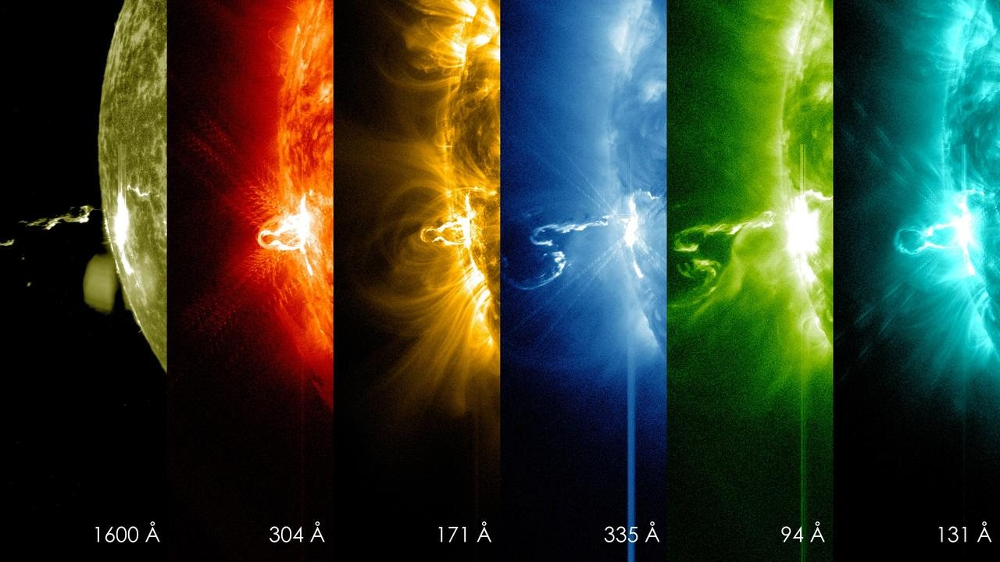

# AI Tools Use and Disclosure


*Illustrative image: [NASA/GSFC](<https://images.nasa.gov/details/GSFC_20171208_Archive_e001210>). This independent guide is not endorsed by NASA.*


## NASA Space Apps Challenge-এ AI-সহায়ক কাজ, যাচাই ও disclosure-এর বাংলা গাইড

> **এটি AI ব্যবহারের সহায়ক গাইড—NASA-র official policy বা কোনো নির্দিষ্ট বছরের অনুমতির বিকল্প নয়।** AI/SI tool ব্যবহার, disclosure, data handling এবং project submission-এর নিয়ম বছর ও event অনুযায়ী বদলাতে পারে। বর্তমান বছরের Participant Terms, Participant FAQs, Challenge Statement, Project Submission Guide ও Local Event-এর নির্দেশনা আগে পড়ুন।
>
> **২০২৬-এ যাচাইকৃত:** NASA Space Apps-এর ২০২৬ Participant FAQ-তে team-কে AI-জাতীয় tool ব্যবহারের অনুমতি দেওয়া হয়েছে এবং project submission-এ কীভাবে সেগুলো ব্যবহার করেছে তা বর্ণনা করতে বলা হয়েছে। একই FAQ সেই বছরের terminology-তে “Super Intelligence (SI)” বলেছে। এই নির্দেশনাকে পরবর্তী বছরের নিয়ম ধরে নেবেন না; current FAQ-তে পুনরায় যাচাই করুন।

## ১. এই guide-এর লক্ষ্য

AI tool brainstorming, coding, translation, summarization, design exploration, data workflow বা prototype-এ সহায়ক হতে পারে। কিন্তু tool:

- ভুল fact, ভুল unit বা ভুয়া citation তৈরি করতে পারে;
- source-এর context বাদ দিতে পারে;
- code-এ bug বা insecure pattern দিতে পারে;
- third-party text/image/code-এর rights প্রশ্ন তৈরি করতে পারে;
- confidential বা ব্যক্তিগত তথ্য প্রক্রিয়াকরণে ঝুঁকি তৈরি করতে পারে;
- data limitation না বুঝে অতিরঞ্জিত conclusion দিতে পারে।

অতএব AI tool-এর output-কে **যাচাই করার খসড়া বা সহায়তা** হিসেবে নিন—স্বয়ংক্রিয়ভাবে সত্য, অনুমোদিত বা team-এর নিজস্ব verified result হিসেবে নয়। Project-এর accuracy, source, quality ও compliance-এর চূড়ান্ত দায়িত্ব team-এর।

## ২. আগে বর্তমান বছরের rule যাচাই

AI tool বা AI-powered feature ব্যবহার করার আগে current-year official sources-এ খুঁজুন:

- AI/SI tool ব্যবহারের অনুমতি বা restriction;
- submission-এ কী disclosure দিতে হবে;
- project-এ AI feature থাকলে model/data সম্পর্কে কী বলতে হবে;
- generated image, text, code বা audio জমার শর্ত;
- third-party service-এ data পাঠানোর restriction;
- citation, licensing ও intellectual-property requirement;
- Local Event বা challenge-specific অতিরিক্ত শর্ত।

Rule অস্পষ্ট হলে submission deadline-এর আগে Local Lead বা official contact-কে লিখিতভাবে জিজ্ঞেস করুন। পুরোনো FAQ, অন্য প্রতিযোগিতা বা অন্য দলের অভিজ্ঞতা দিয়ে current rule অনুমান করবেন না।

### ২০২৬-এর নিয়মের সীমানা

২০২৬ FAQ-তে AI/SI tool ব্যবহার করে কাজ দ্রুত করা, development streamline করা বা creativity বাড়ানোর অনুমতি এবং submission-এ ব্যবহারের বিবরণ দেওয়ার কথা আছে। এটি **২০২৬-এর FAQ-এর সারাংশ**—পরের বছরের blanket permission নয়। FAQ-তে ব্যবহৃত নির্দিষ্ট terminology-ও সেই বছরের। বর্তমান বছরের official language অনুসরণ করুন।

## ৩. AI ব্যবহারের ধরন আলাদা করে চিনুন

Project-এ AI ব্যবহার কয়েকভাবে হতে পারে। Disclosure-এর সময় কোন ধরনের ব্যবহার হয়েছে তা আলাদা করে বলুন।

### A. Development assistant হিসেবে

- idea brainstorm বা outline;
- code completion/debugging;
- documentation বা test-case draft;
- translation বা grammar improvement;
- mock data বা UI copy draft;
- image/icon/slide/voice generation;
- data exploration-এর প্রশ্ন/analysis suggestion।

### B. Project-এর user-facing feature হিসেবে

- user-এর প্রশ্নের উত্তর দেওয়া chatbot;
- image বা text classification;
- recommendation/ranking;
- anomaly detection বা prediction;
- natural-language summary;
- generative image, audio, text বা code feature।

### C. Data processing বা scientific workflow-তে

- feature extraction, segmentation বা labeling;
- model-based estimate;
- data cleaning/classification;
- embedding, retrieval বা summarization;
- synthetic data তৈরি;
- model-assisted interpretation।

একটি project-এ একাধিক ধরন থাকতে পারে। “AI ব্যবহার করেছি” এক লাইনের অস্পষ্ট বক্তব্যের বদলে কোন tool কোথায় ব্যবহৃত হয়েছে লিখুন।

## ৪. AI tool বেছে নেওয়ার আগে

### Tool suitability check

- [ ] কাজটি AI ছাড়া করা সম্ভব, নাকি AI ব্যবহার একটি স্পষ্ট প্রয়োজন মেটায়?
- [ ] Current event rules এই ব্যবহার অনুমোদন করে?
- [ ] Tool-এর terms-এ input, output, privacy, retention ও publication কী বলা?
- [ ] NASA বা third-party data tool-এ পাঠানো অনুমোদিত কি?
- [ ] Tool-এর output যাচাই করার উপায় আছে?
- [ ] Internet/account/API failure হলে project-এর fallback কী?
- [ ] Tool-এর generated output-এ licence বা attribution শর্ত আছে?
- [ ] Team জানে কোন ফল AI দিয়েছে আর কোনটি team যাচাই/পরিবর্তন করেছে?

AI শুধু pitch-এ “innovative” শোনানোর জন্য যোগ করবেন না। Tool-এর input/output user-এর কাজ ও challenge-এর requirement-এর সঙ্গে যুক্ত হতে হবে।

## ৫. নিরাপদ prompt ও data handling

AI service-এ তথ্য পাঠানোর আগে service-এর current privacy/terms পড়ুন। Public service-এ নিচের তথ্য দেবেন না—যদি না সংশ্লিষ্ট policy ও অনুমতি স্পষ্টভাবে তা অনুমোদন করে:

- password, API key, access token, recovery code বা private key;
- ব্যক্তিগতভাবে শনাক্তযোগ্য তথ্য, home address, private phone/email;
- অপ্রাপ্তবয়স্কের নাম, ছবি, voice বা ব্যক্তিগত বিবরণ;
- confidential, proprietary বা business-sensitive তথ্য;
- প্রকাশের অধিকার নেই এমন third-party content;
- restricted বা export-controlled তথ্য;
- team-এর private repository/code, যদি tool ব্যবহারের অনুমতি না থাকে।

### Prompt hygiene

- বাস্তব ব্যক্তির ব্যক্তিগত তথ্যের বদলে anonymized/synthetic example ব্যবহার করুন।
- Secret, credential বা private URL prompt-এ paste করবেন না।
- Prompt-এ source চাইলে model-এর দেওয়া citation-কে verified ধরে নেবেন না।
- Source content paste করলে তার licence এবং external service-এ পাঠানো যাবে কি না যাচাই করুন।
- Tool-কে “তথ্য যাচাই করো” বললেই যাচাই হয়ে যায় না—source নিজে খুলে দেখুন।

## ৬. AI-উৎপন্ন তথ্য ও citation যাচাই

### ৬.১ Fact-check workflow

AI থেকে পাওয়া প্রত্যেক গুরুত্বপূর্ণ factual claim-এর জন্য:

1. claim-টি আলাদা বাক্যে লিখুন;
2. claim-এর জন্য কী ধরনের evidence দরকার ঠিক করুন;
3. cited URL, DOI, dataset page বা paper সত্যিই আছে কি না খুলুন;
4. source-এ একই বক্তব্য আছে কি না context-সহ পড়ুন;
5. date, version, unit, region ও mission/instrument মিলিয়ে দেখুন;
6. challenge-এর full statement ও data product documentation-এর সঙ্গে তুলনা করুন;
7. যাচাই করা source-টি project-এর source register-এ যোগ করুন;
8. নিশ্চিত না হলে claim বাদ দিন বা uncertainty স্পষ্ট করুন।

### ৬.২ Citation-এর ক্ষেত্রে

- AI-generated citation কখনো যাচাই না করে জমা দেবেন না।
- Title, author, agency, DOI, URL, publication year ও dataset version মিলিয়ে নিন।
- NASA/open-data portal-এর official landing page-কে প্রাধান্য দিন।
- Citation format provider নির্ধারণ করলে সেটিই অনুসরণ করুন।
- Model যদি source খুঁজে না পায়, “citation নেই” বলে সেটিকে source হিসেবে ব্যবহার করবেন না।
- ২০২৬ Space Apps Terms অনুযায়ী সব ব্যবহৃত source cite করতে বলা হয়েছে—AI-generated লেখা/কোডের বাইরেও project-এর প্রতিটি data ও asset source record রাখুন।

### Claim check table

| AI/tool-এর claim বা suggestion | যাচাইয়ের official/primary source | যাচাই ফল | Project-এ ব্যবহার |
|---|---|---|---|
| | | Verified / Corrected / Removed | |
| | | Verified / Corrected / Removed | |
| | | Verified / Corrected / Removed | |

## ৭. AI-generated code যাচাই

AI-generated code রান করার আগে:

- [ ] Code কী করে line/function ধরে বুঝেছি।
- [ ] Dependency/package-এর নাম ও official documentation যাচাই।
- [ ] Package version ও licence নথিবদ্ধ।
- [ ] API key, credential বা unsafe network request hard-code হয়নি।
- [ ] File path, user input, permission ও data validation পরীক্ষা।
- [ ] একটি expected test এবং অন্তত একটি invalid/edge input চালিয়েছি।
- [ ] Data transformation, coordinate, unit ও date handling যাচাই।
- [ ] Generated code project-এর licence ও third-party component-এর সঙ্গে সামঞ্জস্যপূর্ণ কি না দেখেছি।
- [ ] Unused, obfuscated বা অজানা code বাদ দিয়েছি।
- [ ] Code review-এর দায়িত্বে থাকা team member ফল বুঝতে পারেন।

“AI code run করেছে” মানেই code নিরাপদ, সঠিক বা scientificভাবে valid—এমন নয়। External code snippet ব্যবহার করলে source/licence যাচাই করুন; model-এর attribution claim-কে প্রমাণ ছাড়া বিশ্বাস করবেন না।

## ৮. AI-উৎপন্ন ছবি, text, audio ও media

- [ ] Current-year submission rules generated media অনুমোদন করে কি না যাচাই।
- [ ] Tool-এর output ownership/licence, attribution ও commercial/publication terms পড়া।
- [ ] Prompt বা output-এ বাস্তব ব্যক্তির likeness/voice, NASA logo বা protected mark আছে কি না দেখা।
- [ ] Generated result বাস্তব NASA photo, satellite observation বা measured output বলে ভুল বোঝায় না।
- [ ] Generated/illustrative visual-কে “AI-generated”, “illustration” বা “concept image” হিসেবে label—যদি বিভ্রান্তির ঝুঁকি থাকে।
- [ ] Scientific visualization হলে colour/shape/data mapping বাস্তব measurement-এর সঙ্গে মেলে।
- [ ] Generated text-এ ভুল fact, exclusionary language বা uncredited copied material নেই।
- [ ] Media-তে থাকা third-party asset ও source আলাদা করে cite করা।

NASA-র website-এ কোনো image থাকলেই সেটি AI model-এর training/output বা project media হিসেবে যেকোনোভাবে ব্যবহার করা যায়—এমন নয়। Asset-এর rights note ও NASA Media Usage Guidelines দেখুন।

## ৯. Project-এর ভিতরে AI model থাকলে

যদি user-facing solution-এ AI/ML model থাকে, pitch ও documentation-এ অন্তত এই বিষয়গুলো প্রস্তুত রাখুন:

| বিষয় | কী ব্যাখ্যা করবেন |
|---|---|
| User-এর কাজ | Model কোন user need-এর অংশ? |
| Input | Model-এ কী data যায়? Sensitive data আছে? |
| Output | Label, probability, ranking, generated text, estimate—কী দেয়? |
| Model/service | Open model, hosted API, rules-based system, নাকি অন্য কিছু? |
| Training/fine-tuning data | Source/permission জানা থাকলে উল্লেখ; অজানা হলে স্পষ্ট বলুন |
| Evaluation | কী sample/test, baseline বা review দিয়ে পরীক্ষা? |
| Error/uncertainty | False positive/negative, bias, coverage gap বা hallucination risk কী? |
| Human role | User বা expert output যাচাই/override করতে পারবেন? |
| Failure behavior | Model/API ব্যর্থ হলে fallback কী? |
| Limitations | কোন region/user/time/data-তে validate হয়নি? |

### Model evaluation-এর সহজ checklist

- Test data training/tuning data থেকে আলাদা কি না—যদি জানা থাকে;
- অন্তত কয়েকটি expected ও failure case পরীক্ষা হয়েছে কি;
- Label/reference data কোথা থেকে এসেছে এবং তার সীমা কী;
- Accuracy সংখ্যা দিলে dataset, test method, sample size ও metric বলা হয়েছে কি;
- ছোট বা biased sample-কে general performance বলা হচ্ছে কি;
- Probability-কে certainty হিসেবে দেখানো হচ্ছে কি;
- Model-এর output মানুষের ক্ষতি/ভুল সিদ্ধান্তে ব্যবহার হতে পারে কি;
- ব্যবহারকারীকে uncertainty ও fallback জানানো আছে কি।

“Model-টি ৯৮% accurate” বলবেন না, যদি সেই সংখ্যা কীভাবে মাপা হয়েছে তা দেখাতে না পারেন।

## ১০. Human review ও কাজের দায়িত্ব

AI assistant workstream-এর সাহায্য করতে পারে, কিন্তু final responsibility team-এর:

- একজন human factual claims ও citations যাচাই করবেন;
- একজন code owner generated code বুঝে test করবেন;
- project owner generated media/source rights যাচাই করবেন;
- submission owner disclosure field current guide অনুযায়ী পূরণ করবেন;
- team-এর সদস্যরা contribution ও AI assistance-কে সঠিকভাবে আলাদা করবেন।

AI output-কে একজন team member-এর নিজস্ব যাচাইকৃত contribution হিসেবে ভুলভাবে credit দেবেন না। আবার AI-কে ব্যবহার করেছে বলে team-এর মানবিক কাজ অস্বীকার করারও প্রয়োজন নেই—কীভাবে ব্যবহার হয়েছে তা নির্দিষ্টভাবে বলুন।

## ১১. Disclosure কীভাবে লিখবেন

### ১১.১ Disclosure-এর নীতি

একটি ব্যবহারযোগ্য disclosure:

- **সত্য:** tool কী করেছে, কী করেনি—সেটি ঠিকভাবে বলে;
- **নির্দিষ্ট:** নাম, কাজের ধরন ও project-এর কোন অংশে ব্যবহৃত—যতটা প্রাসঙ্গিক;
- **স্বচ্ছ:** generated output team কীভাবে যাচাই/সম্পাদনা করেছে;
- **সংক্ষিপ্ত:** অপ্রয়োজনীয় marketing language নেই;
- **প্রয়োজনমাফিক:** current submission form-এর field ও word limit মেনে চলে।

### ১১.২ সাধারণ disclosure template

```text
AI/SI tool use:
Tool/provider:
কাজের সময়/তারিখ (প্রয়োজনে):
ব্যবহারের উদ্দেশ্য:
Project-এর কোন অংশে ব্যবহার:
Tool output থেকে কী রাখা/বদলানো/বাদ দেওয়া হয়েছে:
Fact/source/code/media কীভাবে যাচাই করেছি:
কোন limitation বা unverified অংশ আছে:
```

### ১১.৩ ছোট disclosure example

**উদাহরণ—নিজের বাস্তব ব্যবহারের সঙ্গে মিলিয়ে লিখবেন:**

> “আমরা [tool/provider] ব্যবহার করেছি [নির্দিষ্ট কাজ]-এর খসড়া/সহায়তার জন্য। Tool-এর output team পর্যালোচনা ও সম্পাদনা করেছে। Scientific দাবি ও data reference [official source]-এর সঙ্গে যাচাই করেছি; tool-এর কোনো output-কে যাচাইহীন evidence হিসেবে ব্যবহার করিনি।”

### ১১.৪ Coding assistant disclosure example

> “একটি coding assistant ব্যবহার করে [নির্দিষ্ট function/test/UI] তৈরির খসড়া পেয়েছি। Team code review, dependency/licence check ও test করেছে এবং final implementation-এর দায়িত্ব নিয়েছে।”

### ১১.৫ AI-feature disclosure example

> “Project-এর [feature]-এ [model/service]-কে [input] দিয়ে [output] তৈরিতে ব্যবহার করা হয়। আমরা এটি [test method/sample]-এ পরীক্ষা করেছি। এটি [limitation]-এর জন্য validated নয়; output-কে নিশ্চিত তথ্য/পরামর্শ হিসেবে ধরা যাবে না।”

এই উদাহরণগুলো template—NASA-র নির্দিষ্ট form text নয়। Form যদি পৃথকভাবে tool, model, input, data source বা evaluation জানতে চায়, সেই field-গুলোও পূরণ করুন।

## ১২. Disclosure log

Event-এর সময়েই log রাখুন; জমার আগে স্মৃতি থেকে তৈরি করবেন না।

| তারিখ | Tool/provider | ব্যবহার | Project-এর কোন অংশ | Human review/test | রাখা/বদলানো/বাদ |
|---|---|---|---|---|---|
| | | | | | |
| | | | | | |
| | | | | | |

Sensitive prompt, credential বা ব্যক্তিগত তথ্য log-এ লিখবেন না।

## ১৩. কখন AI output ব্যবহার না করাই ভালো?

- Output-এর source বা permission যাচাই করা যায় না;
- Tool restricted/confidential data নিতে বলছে;
- Output-এ ব্যক্তির likeness, copyrighted asset বা NASA identifier-এর অননুমোদিত ব্যবহার;
- Model-এর ভুল project-এর user-কে উল্লেখযোগ্য ক্ষতি করতে পারে এবং safeguard নেই;
- Team output বুঝতে বা evaluate করতে পারছে না;
- Tool-এর internet/account/latency dependency demo-কে অস্থিতিশীল করে;
- AI output challenge-এর requirement-এর বদলে project-কে generic করে দিচ্ছে;
- Current-year rule বা licence নিয়ে গুরুতর অনিশ্চয়তা আছে।

এমন ক্ষেত্রে feature বাদ দিন, deterministic/simple method নিন, scope ছোট করুন বা official guidance নিন।

## ১৪. Common failure ও প্রতিকার

| সমস্যা | কীভাবে ধরা পড়ে | করণীয় |
|---|---|---|
| ভুয়া citation/DOI | Link খোলে না বা metadata মেলে না | Official source খুলে যাচাই; না মিললে বাদ |
| Hallucinated fact | Challenge/data documentation-এ নেই | Claim সরান বা primary source দিয়ে সংশোধন |
| ভুল code | Test fail, output অস্বাভাবিক, data corruption | ছোট test, review, known-good implementation |
| Insecure secret handling | Key code/screenshot-এ দৃশ্যমান | Secret সরান, revoke/rotate, history পরীক্ষা |
| Unlicensed media | Creator/terms অজানা | Asset বাদ/বদল বা permission সংগ্রহ |
| Bias/coverage gap | নির্দিষ্ট group/region-এ ফল খারাপ | scope সীমিত, test/limitation প্রকাশ, human review |
| False confidence | Uncertainty ছাড়া probability/claim | Calibration/validation না থাকলে নিশ্চিত ভাষা বাদ |
| Privacy leakage | Prompt-এ personal/confidential তথ্য পাঠানো | Tool-এ পাঠানো বন্ধ; incident policy অনুযায়ী ব্যবস্থা |
| Tool outage | Login/API/network failure | Local sample, static fallback, demo disclosure |
| AI-কে পুরো কাজের মালিক বলা | Team নিজে code/result বুঝতে পারে না | মানব review ও contribution record পরিষ্কার |

## ১৫. Final AI-use checklist

### Policy ও disclosure

- [ ] Current-year AI/SI rule, Terms ও submission guide পড়েছি।
- [ ] Submission form-এ AI/tool disclosure কীভাবে চাওয়া হয়েছে জানি।
- [ ] Tool use log থেকে disclosure লিখেছি; ভুল বা অতিরঞ্জিত দাবি নেই।
- [ ] AI feature ও development assistance—দুই ধরনের ব্যবহার থাকলে দুটোই উল্লেখ করেছি।

### Facts ও sources

- [ ] গুরুত্বপূর্ণ factual claim primary/official source দিয়ে যাচাই।
- [ ] AI-suggested citation/DOI/URL খুলে পরীক্ষা।
- [ ] Data, paper, code, image, model ও asset-এর source/rights নথিবদ্ধ।
- [ ] Unknown/uncertain result-কে verified বলে উপস্থাপন করিনি।

### Code ও media

- [ ] Generated code বুঝেছি, review করেছি ও test করেছি।
- [ ] Dependency/package licence যাচাই।
- [ ] API key, password ও private data public content-এ নেই।
- [ ] Generated media/tool terms ও third-party rights পরীক্ষা।
- [ ] AI-illustration বা synthetic data বাস্তব NASA observation বলে বিভ্রান্ত করে না।

### Privacy ও reliability

- [ ] Personal/confidential/restricted data অননুমোদিত tool-এ পাঠাইনি।
- [ ] AI/API failure-এর fallback আছে।
- [ ] User-facing AI output-এর limitation ও uncertainty বলা আছে।
- [ ] Human reviewer final output ও submission অনুমোদন করেছেন।

## ১৬. Copy-ready AI-use register

```text
# AI/SI Use Register

Project:
Team:
Current-year rule/FAQ URL:

## Tool use
Tool/provider:
Use type: Development aid / Project feature / Data processing / Media / Other
Purpose:
Project component:
Input type (sensitive information ছাড়া):
Output type:
Human edits:

## Verification
Facts/citations checked against:
Code tests/review:
Media/licence check:
Model/data evaluation:
Known limitation:
Fallback:

## Submission disclosure
Form field:
Final disclosure text:
Reviewed by:
Date:
```

## ১৭. সম্পর্কিত গাইড

- [NASA Space Apps Challenge Guidelines](../01-Getting%20Started/NASA%20Space%20Apps%20Challenge%20Guidelines.md)
- [NASA Open Data Guide](./NASA%20Open%20Data%20Guide.md)
- [Space Apps Tools and Tech Stack](./Space%20Apps%20Tools%20and%20Tech%20Stack.md)
- [Project Submission Checklist](../04-Build%20and%20Submit/Project%20Submission%20Checklist.md)
- [Project Pitch and Demo Guide](../04-Build%20and%20Submit/Project%20Pitch%20and%20Demo%20Guide.md)
- [NASA Space Apps Project Roadmap](../02-Planning%20and%20Team/NASA%20Space%20Apps%20Project%20Roadmap.md)

## ১৮. Official references

- [NASA Space Apps Participant FAQs](https://www.spaceappschallenge.org/resources/participant-faqs/)
- [NASA Space Apps Participant Terms and Conditions](https://www.spaceappschallenge.org/legal/)
- [NASA Space Apps Resources](https://www.spaceappschallenge.org/resources/)
- [NASA Space Apps Contact](https://www.spaceappschallenge.org/contact-space-apps/)
- [NASA Media Usage Guidelines](https://www.nasa.gov/nasa-brand-center/images-and-media/)

> **শেষ কথা:** AI tool ব্যবহার করা মানেই disclosure যথেষ্ট নয়। Current rules মানুন, source ও output নিজে যাচাই করুন, privacy ও licence রক্ষা করুন, tool-এর ভূমিকা সৎভাবে জানান এবং team-এর হাতে final result-এর দায়িত্ব রাখুন।
