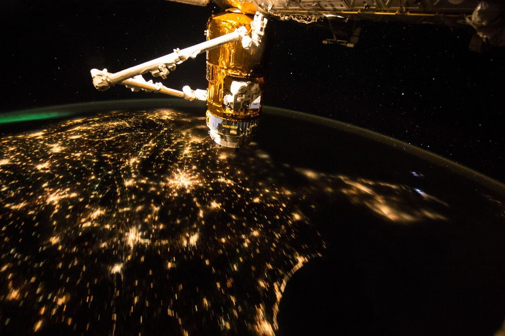

# NASA Space Apps Challenge 2024: সম্পূর্ণ বাংলা গাইড

*Illustrative image: [NASA/JSC](<https://images.nasa.gov/details/iss045e013851>). This independent guide is not endorsed by NASA.*

> **নথির পরিধি:** NASA Space Apps Challenge 2024-এর ২০টি নম্বরযুক্ত challenge এবং অতিরিক্ত **Create Your Own Challenge** বিকল্প। এখানে প্রতিটি challenge-এর অফিসিয়াল মূল বক্তব্য বাংলায় ব্যাখ্যা করা হয়েছে; এরপর আলাদা করে সম্ভাব্য সমাধানের ধারণা, কাজের ধাপ, দলীয় ভূমিকা ও যাচাইয়ের পরামর্শ দেওয়া হয়েছে।
>
> **গুরুত্বপূর্ণ:** সম্ভাব্য প্রকল্প, টুল ও কাজের ধাপগুলো শিক্ষামূলক পরামর্শ—এসবকে NASA-র বাধ্যতামূলক নিয়ম বা অফিসিয়াল judging rubric মনে করবেন না। নির্দিষ্ট challenge-এর সম্পূর্ণ statement ও Resources tab দেখতে সংশ্লিষ্ট অফিসিয়াল লিংকে যান।

## ১. NASA Space Apps Challenge কী?

NASA Space Apps Challenge হলো NASA-সমর্থিত একটি বৈশ্বিক, উন্মুক্ত hackathon। বিভিন্ন দেশের শিক্ষার্থী, শিক্ষক, বিজ্ঞানী, ডিজাইনার, সফটওয়্যার নির্মাতা, শিল্পী ও সাধারণ মানুষ দল গঠন করে পৃথিবী ও মহাকাশবিষয়ক সমস্যা নিয়ে কাজ করেন। লক্ষ্য কেবল কোড লেখা নয়: উন্মুক্ত NASA/বৈজ্ঞানিক তথ্যকে বোঝা, সৃজনশীলভাবে ব্যবহার করা, এবং অন্য মানুষের কাছে ফলটি সহজে পৌঁছে দেওয়া।

### ১.১ ২০২৪ সালের আয়োজন

- ২০২৪ সালের hackathon অনুষ্ঠিত হয় **৫–৬ অক্টোবর ২০২৪**।
- অফিসিয়াল challenge পৃষ্ঠায় ২০২৪ সালের event-কে এখন **closed** বলা হয়েছে। তাই এটি অতীতের আয়োজনের গাইড; বর্তমান নিবন্ধন বা জমা দেওয়ার নির্দেশনা নয়।
- challenge-গুলোর বিষয় পৃথিবী পর্যবেক্ষণ, জলবায়ু, কৃষি, মহাকাশবিজ্ঞান, গ্রহ, শিক্ষা, গেম, সংগীত, মানচিত্র ও ভিজ্যুয়ালাইজেশন পর্যন্ত বিস্তৃত।
- অফিসিয়াল challenge তালিকায় ২০টি নম্বরযুক্ত challenge-এর পাশাপাশি “Create Your Own Challenge” বিকল্পও আছে।

### ১.২ Challenge আর local event এক জিনিস নয়

**Challenge** হলো প্রকল্পের বিষয় বা সমস্যা। **Local event** হলো কোনো শহর/অঞ্চলে অংশগ্রহণকারীরা যে স্থানীয় venue বা অনলাইন ব্যবস্থায় একত্র হন। একটি challenge বহু local event-এর দল বেছে নিতে পারে। তাই challenge-কে আলাদা ২০টি অনুষ্ঠান বলে ভাবার চেয়ে, একই hackathon-এর ২০টি প্রকল্প-প্রশ্ন হিসেবে বোঝা বেশি ঠিক।

### ১.৩ NASA-র তথ্য ব্যবহার মানে কী?

প্রকল্পে NASA বা অন্য বৈজ্ঞানিক সংস্থার উন্মুক্ত তথ্য/চিত্র ব্যবহার করা যেতে পারে। তবে:

1. ডেটা কোথা থেকে এসেছে, তার নাম ও লিংক লিখুন।
2. ডেটার সময়কাল, স্থানিক পরিসর, একক ও সীমাবদ্ধতা যাচাই করুন।
3. মানচিত্র বা গ্রাফে ডেটা কী বোঝায় তা পরিষ্কারভাবে ব্যাখ্যা করুন।
4. পর্যবেক্ষণ, মডেল-ভিত্তিক অনুমান ও নিজের ব্যাখ্যাকে এক জিনিস হিসেবে উপস্থাপন করবেন না।
5. কোনো ফলকে বৈজ্ঞানিকভাবে নিশ্চিত সিদ্ধান্ত বলার আগে উৎস/বিশেষজ্ঞের যাচাই প্রয়োজন কি না উল্লেখ করুন।

## ২. দ্রুত সূচি

| ক্রম | অফিসিয়াল challenge | মূল ক্ষেত্র |
|---|---|---|
| ১ | Landsat Reflectance Data: On the Fly and at Your Fingertips | Landsat, মাঠের পর্যবেক্ষণ, ওয়েব অ্যাপ |
| ২ | SDGs in the Classroom | শিক্ষা, টেকসই উন্নয়ন |
| ৩ | Exosky! | বহিঃগ্রহ, তারামানচিত্র |
| ৪ | Navigator for the Habitable Worlds Observatory (HWO) | HWO, বহিঃগ্রহ |
| ৫ | Seismic Detection Across the Solar System | Apollo ও InSight ভূকম্পন-তথ্য |
| ৬ | GLOBE Protocol Games | বিজ্ঞানভিত্তিক খেলা, পরিবেশ |
| ৭ | Galactic Games: Fun in a Microgravity Environment! | মহাকাশচারী, মাইক্রোগ্র্যাভিটি |
| ৮ | Chronicles of Exoplanet Exploration | বহিঃগ্রহ শিক্ষা |
| ৯ | Visualize Space Science | মহাকাশে জীববিজ্ঞান পরীক্ষা |
| ১০ | Symphony of the Stars: Harmonizing the James Webb Space Telescope in Music and Images | JWST, ছবি, সংগীত |
| ১১ | Create an Orrery Web App that Displays Near-Earth Objects | সৌরজগৎ, নিকট-পৃথিবী বস্তু |
| ১২ | PACE in the Classroom | PACE, মহাসাগর শিক্ষা |
| ১৩ | Beyond Sunlight: An Aquatic Chemosynthetic World | কেমোসিন্থেসিস, মহাসাগরীয় জগৎ |
| ১৪ | Imagine our Connected Earth | পৃথিবী-ব্যবস্থার আন্তঃসম্পর্ক |
| ১৫ | Leveraging Earth Observation Data for Informed Agricultural Decision-Making | কৃষি, পানি, স্যাটেলাইট ডেটা |
| ১৬ | Community Mapping | GIS, স্থানীয় সমস্যা |
| ১৭ | Human Development & the Environment | মানব উন্নয়ন, পরিবেশ, SDG |
| ১৮ | Uncover the Role of Greenhouse Gases in Your Neighborhood! | গ্রিনহাউস গ্যাস, মানচিত্র |
| ১৯ | Tell Us a Climate Story! | জলবায়ু-তথ্য দিয়ে গল্প |
| ২০ | Show Us What the May 2024 Geomagnetic Storms Looked Like | সূর্য, মহাকাশ আবহাওয়া |
| অতিরিক্ত | Create Your Own Challenge | নিজের সমস্যা/প্রকল্প |

> ক্রম ৫ ও ৬-সহ তালিকার নম্বরগুলো challenge-গুলোর অফিসিয়াল নম্বরকে অনুসরণ করে। কিছু কার্ডে নম্বর দৃশ্যমান না হলেও অফিসিয়াল challenge statement-এ সেই নম্বর ব্যবহৃত হয়।

---

# ৩. প্রতিটি challenge-এর বিস্তারিত ব্যাখ্যা

## Challenge 1 — Landsat Reflectance Data: On the Fly and at Your Fingertips

**সহজ বাংলা নাম:** Landsat-এর প্রতিফলন-তথ্য—উপগ্রহ আসার সময় জানুন, ডেটা হাতের কাছে পান  
**মূল ক্ষেত্র:** পৃথিবী পর্যবেক্ষণ, Landsat, ভূমির প্রতিফলন, ওয়েব অ্যাপ  
**অফিসিয়াল পৃষ্ঠা:** [Landsat Reflectance Data: On the Fly and at Your Fingertips](https://www.spaceappschallenge.org/nasa-space-apps-2024/challenges/landsat-reflectance-data-on-the-fly-and-at-your-fingertips/)

### সমস্যাটি কী?

Landsat মিশন বহু দশক ধরে পৃথিবীর স্থলভাগের উপগ্রহ-পরিমাপ সংগ্রহ করেছে। ভূমিতে কোনো বস্তু বা এলাকার প্রতিফলনের বৈশিষ্ট্য মাপা হলে সেটিকে একই সময়ের Landsat Surface Reflectance (SR) তথ্যের সঙ্গে তুলনা করে শেখা ও অনুসন্ধান করা যায়। কিন্তু ব্যবহারকারীর আগে জানতে হয় Landsat কখন নির্দিষ্ট স্থানের ওপর দিয়ে যাবে; পরে ওই স্থান ও সময়ের সংশ্লিষ্ট ডেটা খুঁজে পেতে হয়।

### চ্যালেঞ্জের মূল লক্ষ্য

এমন একটি ওয়েব-ভিত্তিক অ্যাপ বানানো, যাতে ব্যবহারকারী:

1. মানচিত্রে বা স্থানাঙ্ক দিয়ে লক্ষ্যস্থান বেছে নিতে পারেন।
2. Landsat কখন ওই স্থানের ওপর দিয়ে যাবে, তা জানতে পারেন।
3. উপগ্রহের সম্ভাব্য pass-এর জন্য notification বা reminder পান।
4. সংশ্লিষ্ট সময়ের Landsat Surface Reflectance ডেটা দেখতে বা অ্যাক্সেস করতে পারেন।
5. সম্ভব হলে নিজের মাঠের পর্যবেক্ষণের সঙ্গে উপগ্রহের তথ্য তুলনা করতে পারেন।

### ভালো সমাধানে কী দেখা যেতে পারে?

- স্থান নির্বাচন এবং স্থানাঙ্ক-ভিত্তিক অনুসন্ধান।
- pass-এর তারিখ/সময়, সময় অঞ্চল এবং পূর্বাভাসের অনিশ্চয়তা স্পষ্টভাবে দেখানো।
- স্যাটেলাইটের পাসের সময় মেঘ বা ডেটার অনুপস্থিতি থাকলে তা দেখানো।
- তারিখভিত্তিক Landsat image/SR layer এবং প্রাসঙ্গিক metadata।
- মাঠে নেওয়া পর্যবেক্ষণ নোট যোগ করার ব্যবস্থা।
- একই স্থানের দুই বা একাধিক সময়ের ছবি পাশাপাশি তুলনা।
- ডেটার উৎস, band, scale ও সীমাবদ্ধতার পরিচিতি।

### সম্ভাব্য কাজের ধাপ

1. ব্যবহারকারীর প্রশ্ন নির্ধারণ করুন—যেমন “আমার এলাকার গাছপালা/জলাশয় কীভাবে বদলেছে?”
2. Landsat-এর উন্মুক্ত data/API/সেবা এবং pass-সংক্রান্ত তথ্যের উৎস যাচাই করুন।
3. স্থান নির্বাচন, তারিখ অনুসন্ধান এবং ফল প্রদর্শনের একটি ছোট prototype তৈরি করুন।
4. image-কে সঠিক স্থানাঙ্কে map-এ বসান।
5. cloud cover, missing values, projection এবং তারিখের মতো metadata প্রকাশ করুন।
6. ভিন্ন ডিভাইস/নেটওয়ার্কে ব্যবহারযোগ্যতা পরীক্ষা করুন।

### সতর্কতা

Satellite overpass মানেই ছবিতে পরিষ্কার ভূমি দেখা যাবে—এমন নয়। মেঘ, sensor-এর সীমা, data latency এবং নির্বাচিত সময়ের উপলভ্যতা ফলকে প্রভাবিত করতে পারে। তাই অ্যাপ যেন “ডেটা নেই” অবস্থাকেও পরিষ্কারভাবে বোঝায়।

---

## Challenge 2 — SDGs in the Classroom

**সহজ বাংলা নাম:** শ্রেণিকক্ষে টেকসই উন্নয়ন লক্ষ্যমাত্রা  
**মূল ক্ষেত্র:** শিক্ষা, বিজ্ঞান-পাঠ, জাতিসংঘের SDG  
**অফিসিয়াল পৃষ্ঠা:** [SDGs in the Classroom](https://www.spaceappschallenge.org/nasa-space-apps-2024/challenges/sdgs-in-the-classroom/)

### সমস্যাটি কী?

জাতিসংঘের ২০৩০ সালের Sustainable Development Goals (SDGs) বৈশ্বিক সমস্যার মোকাবিলায় ১৭টি লক্ষ্য নির্ধারণ করে। শিক্ষার্থীদের কাছে এই লক্ষ্যগুলোকে বাস্তব ও আকর্ষণীয় করে তোলা এবং বিজ্ঞান-পাঠের সঙ্গে যুক্ত করার নতুন উপায় দরকার।

### চ্যালেঞ্জের মূল লক্ষ্য

উচ্চমাধ্যমিক পর্যায়ের শিক্ষার্থীদের জন্য এমন একটি lesson plan তৈরি করা, যা:

- একটি SDG শেখায়;
- ইতিমধ্যে পাঠ্যক্রমে থাকা কোনো বিজ্ঞান-ইউনিটের সঙ্গে যুক্ত হয়;
- আবহাওয়া, ভূতত্ত্ব, মাটির স্বাস্থ্য ইত্যাদি বিষয়ের সঙ্গে প্রাসঙ্গিক হতে পারে;
- শিক্ষার্থীকে শুধু পড়তে নয়, প্রশ্ন করতে, তথ্য দেখতে বা কাজ করে শিখতে সাহায্য করে।

### সম্ভাব্য deliverable

- শিক্ষক-ব্যবহারযোগ্য lesson plan;
- শিক্ষার্থীর worksheet, কার্যপত্র বা ছোট inquiry project;
- ইন্টার‌্যাকটিভ ওয়েবসাইট, স্লাইড, ছোট গেম বা printable activity;
- পাঠের উদ্দেশ্য, উপকরণ, সময়, ধাপ ও মূল্যায়নসহ একটি classroom package।

### পরিকল্পনার কাঠামো

1. একটি SDG বেছে নিন এবং সেটি কোন বাস্তব সমস্যা নিয়ে তা ব্যাখ্যা করুন।
2. বিজ্ঞান-পাঠের সঙ্গে যোগসূত্র দেখান—যেমন জলবায়ু, জল, মাটি, জীববৈচিত্র্য।
3. বয়স ও শ্রেণি অনুযায়ী শেখার লক্ষ্য লিখুন।
4. একটি অনুসন্ধানমূলক কার্যক্রম দিন: অনুমান, পর্যবেক্ষণ, ডেটা, আলোচনা।
5. শিক্ষার্থীরা কী শিখেছে, তা যাচাই করার সহজ rubric/প্রশ্ন দিন।
6. কম ইন্টারনেট, কম খরচ, প্রতিবন্ধী শিক্ষার্থী ও বিভিন্ন ভাষাভাষীর জন্য বিকল্প রাখুন।

### সতর্কতা

SDG-কে শুধু পোস্টার বা স্লোগানে সীমাবদ্ধ করবেন না। শিক্ষার্থী কীভাবে প্রমাণ, পরিমাপ বা দৈনন্দিন অভিজ্ঞতার সঙ্গে লক্ষ্যটি যুক্ত করবে, সেটি দেখানো বেশি কার্যকর।

---

## Challenge 3 — Exosky!

**সহজ বাংলা নাম:** অন্য গ্রহের আকাশ  
**মূল ক্ষেত্র:** বহিঃগ্রহ, নক্ষত্র, জ্যোতির্বিজ্ঞান শিক্ষা  
**অফিসিয়াল পৃষ্ঠা:** [Exosky!](https://www.spaceappschallenge.org/nasa-space-apps-2024/challenges/exosky/)

### সমস্যাটি কী?

পৃথিবী থেকে দেখা রাতের আকাশের চেহারা নির্ভর করে আমরা কোথায় দাঁড়িয়ে আছি। কোনো বহিঃগ্রহে দাঁড়ালে তার আকাশে দৃশ্যমান তারার অবস্থান ও উজ্জ্বলতা ভিন্ন হতে পারে। NASA Exoplanet Archive-এ থাকা হাজার হাজার বহিঃগ্রহের তথ্য এবং তারার catalog একত্র করলে সেই কল্পিত দৃষ্টিকোণ তৈরি করা সম্ভব।

### চ্যালেঞ্জের মূল লক্ষ্য

শিক্ষার্থীদের জন্য এমন অ্যাপ বা interface বানানো, যেখানে তারা:

1. একটি বহিঃগ্রহ বেছে নিতে পারে;
2. ওই গ্রহ থেকে দেখা তারার interactive chart পেতে পারে;
3. নিজস্ব constellation আঁকতে ও নাম দিতে পারে;
4. চার্টটি উচ্চমানের ছবি হিসেবে export/print বা computer/VR-এ দেখতে পারে।

### সম্ভাব্য পণ্য

- browser-ভিত্তিক star map;
- গ্রহ বেছে নেওয়ার search/filter;
- constellation আঁকার canvas;
- তারার নাম/brightness/দূরত্বের তথ্য;
- exportable poster বা VR-view format;
- শিশু ও নতুন শিক্ষার্থীদের জন্য guided mode।

### বৈজ্ঞানিক ও UX বিবেচনা

- কোনো গ্রহের অবস্থান থেকে আকাশ গণনার জন্য পর্যবেক্ষক-গ্রহের অবস্থান, তারা-তালিকা ও coordinate transformation ঠিকভাবে ব্যবহার করতে হয়।
- বাস্তব জ্যোতির্বৈজ্ঞানিক তথ্য এবং ব্যবহারকারীর তৈরি constellation আলাদা করে চিহ্নিত করুন।
- star brightness-এর scale বুঝিয়ে দিন; প্রয়োজনে সীমিত সংখ্যক তারাকে default-এ দেখান।
- গ্রহের atmosphere বা দিনের/রাতের আকাশের প্রভাব মডেল করা না হলে তা দাবি করবেন না।

### একটি কার্যকর demo

তিনটি বহিঃগ্রহ বাছাইয়ের সুযোগ দিয়ে প্রতিটির star chart দেখানো, একটি constellation আঁকা, নাম দেওয়া এবং ছবিটি download করা—এতটুকুই স্পষ্টভাবে কাজ করলে ভালো prototype হতে পারে।

---

## Challenge 4 — Navigator for the Habitable Worlds Observatory (HWO): Mapping the Characterizable Exoplanets in our Galaxy

**সহজ বাংলা নাম:** HWO-র জন্য সম্ভাব্য বহিঃগ্রহের মানচিত্র  
**মূল ক্ষেত্র:** Habitable Worlds Observatory, বহিঃগ্রহ পর্যবেক্ষণ, ডেটা ভিজ্যুয়ালাইজেশন  
**অফিসিয়াল পৃষ্ঠা:** [Navigator for the Habitable Worlds Observatory (HWO)](https://www.spaceappschallenge.org/nasa-space-apps-2024/challenges/navigator-for-the-habitable-worlds-observatory-hwo-mapping-the-characterizable-exoplanets-in-our-galaxy/)

### সমস্যাটি কী?

ভবিষ্যতের Habitable Worlds Observatory (HWO) কোন পরিচিত বহিঃগ্রহ পর্যবেক্ষণ করতে পারবে এবং কোনগুলোকে আরও ভালোভাবে characterize করা সম্ভব হতে পারে—এটি বোঝার জন্য পর্যবেক্ষণ-লক্ষ্যগুলোকে দৃশ্যমান করা দরকার।

### চ্যালেঞ্জের মূল লক্ষ্য

এমন একটি অ্যাপ তৈরি করা, যা ব্যবহারকারীকে:

- সৌর-প্রতিবেশের পরিচিত বহিঃগ্রহ দেখতে দেয়;
- আমাদের ছায়াপথে তাদের অবস্থান/দিকের ধারণা দেয়;
- HWO-র সম্ভাব্য পর্যবেক্ষণ বা characterization-এর সম্ভাবনা অনুসারে লক্ষ্য তুলনা করতে সাহায্য করে;
- পর্যবেক্ষণ-পথ/দৃশ্যমানতার তথ্য অনুধাবনযোগ্যভাবে দেখায়।

### সম্ভাব্য অ্যাপের অংশ

- 2D sky map বা 3D galaxy visualization;
- গ্রহের নাম, তারকা, দূরত্ব ও জানা বৈশিষ্ট্যসহ search;
- সম্ভাব্য পর্যবেক্ষণ-লক্ষ্য filter;
- বিভিন্ন সম্ভাবনার স্তর দেখানো legend;
- নির্বাচিত গ্রহে ক্লিক করলে তথ্য-কার্ড;
- ডেটা উৎস এবং অনুমানের ব্যাখ্যা।

### গুরুত্বপূর্ণ ব্যাখ্যা

“Habitability” বা “characterizable” হওয়া মানেই সেখানে প্রাণ আছে—এমন নয়। অ্যাপটি পর্যবেক্ষণযোগ্যতা বা সম্ভাব্য বৈজ্ঞানিক আগ্রহ দেখাবে; জীবনের অস্তিত্ব নিশ্চিত করবে না। HWO ভবিষ্যৎ observatory হওয়ায় কোনো simulation-এ ব্যবহার করা assumptions স্পষ্টভাবে লিখতে হবে।

### কাজের পরামর্শ

প্রথমে পরিচিত exoplanet catalog-এর ছোট subset নিন। তারপর distance/sky position-ভিত্তিক মানচিত্র তৈরি করুন; প্রমাণসমর্থিত observability score বা category থাকলে সেটি সূত্রসহ দেখান। সঠিক score-এ পৌঁছাতে না পারলে “illustrative visualization” বলে লেবেল দিন।

---

## Challenge 5 — Seismic Detection Across the Solar System

**সহজ বাংলা নাম:** সৌরজগতের বিভিন্ন জগতে ভূকম্পন শনাক্তকরণ  
**মূল ক্ষেত্র:** Apollo, Mars InSight, signal processing, ভূকম্পন  
**অফিসিয়াল পৃষ্ঠা:** [Seismic Detection Across the Solar System](https://www.spaceappschallenge.org/nasa-space-apps-2024/challenges/seismic-detection-across-the-solar-system/)

### সমস্যাটি কী?

চাঁদ বা মঙ্গলে lander-এর শক্তি সীমিত। সব seismic data ক্রমাগত পৃথিবীতে পাঠানো ব্যয়বহুল; অথচ সংগৃহীত সংকেতের একটি অংশই বৈজ্ঞানিকভাবে গুরুত্বপূর্ণ হতে পারে। তাই lander-কে সংকেত ও noise আলাদা করতে শেখানো গেলে অপ্রয়োজনীয় ডেটা কম পাঠানো সম্ভব।

### চ্যালেঞ্জের মূল লক্ষ্য

Apollo mission এবং Mars InSight Lander-এর বাস্তব seismic data বিশ্লেষণ করে noise-এর মধ্যে ভূকম্পন/quake signal শনাক্ত করার computer program তৈরি করা।

### সম্ভাব্য সমাধানের উপাদান

- raw waveform পড়া ও পরিষ্কারভাবে plot করা;
- filtering, windowing বা frequency analysis;
- quake বনাম background noise চিহ্নিত করার নিয়ম বা classifier;
- শনাক্ত ঘটনার start/end time ও confidence দেখানো;
- false positive ও miss হওয়া event তুলনা;
- resource-limited lander-এ algorithm চালানোর ধারণা।

### কাজের ধাপ

1. অফিসিয়াল resource-এ দেওয়া Apollo/InSight dataset ও label বুঝুন।
2. train/test data আলাদা রাখুন; একই event-এর অংশ দুই ভাগে চলে গেলে leakage হতে পারে।
3. baseline detector তৈরি করুন—যেমন amplitude threshold বা frequency rule।
4. algorithm-এর ফল labeled data-এর সঙ্গে তুলনা করুন।
5. precision/recall, false alarm এবং missed event-এর সংখ্যা জানান।
6. noise-এর ধরন বদলালে ফল কেমন হয় পরীক্ষা করুন।

### সতর্কতা

একটি সুন্দর waveform image নিজে নিজে নির্ভুল detector নয়। প্রশিক্ষণ/পরীক্ষার পদ্ধতি এবং ভুল শনাক্তকরণের ফল প্রকাশ করুন। পৃথিবীর ভূমিকম্পের নিয়ম চাঁদ ও মঙ্গলে হুবহু প্রযোজ্য ধরে নেবেন না।

---

## Challenge 6 — GLOBE Protocol Games

**সহজ বাংলা নাম:** GLOBE প্রোটোকল দিয়ে পরিবেশবিষয়ক খেলা  
**মূল ক্ষেত্র:** গেম, পরিবেশবিজ্ঞান, নাগরিক-বিজ্ঞান  
**অফিসিয়াল পৃষ্ঠা:** [GLOBE Protocol Games](https://www.spaceappschallenge.org/nasa-space-apps-2024/challenges/globe-protocol-games/)

### সমস্যাটি কী?

বিজ্ঞান ও পরিবেশ শেখা আনন্দদায়ক হতে পারে। GLOBE Program-এর পর্যবেক্ষণ-প্রোটোকল ব্যবহার করে খেলোয়াড় স্থানীয় পরিবেশ পর্যবেক্ষণ করতে, বৈজ্ঞানিক ধারণা শিখতে এবং পরিবেশগত সমস্যা সম্পর্কে সচেতন হতে পারে।

### চ্যালেঞ্জের মূল লক্ষ্য

একটি game তৈরি করা, যা GLOBE-এর এক বা একাধিক protocol-কে অন্তর্ভুক্ত করে এবং খেলোয়াড়কে:

- নিজের চারপাশের পৃথিবী বুঝতে;
- নগরায়ণ, জলদূষণ, খরা, তাপপ্রবাহ বা বন্যার মতো বিষয়ে সচেতন হতে;
- স্থানীয় community-তে পর্যবেক্ষণ করতে;
- বৈজ্ঞানিক নীতি শিখতে সাহায্য করে।

### সম্ভাব্য গেমের ধরন

- মোবাইল field mission: তাপমাত্রা/মেঘ/জল-সম্পর্কিত পর্যবেক্ষণ;
- quiz-ভিত্তিক adventure;
- দলীয় data collection challenge;
- ভার্চুয়াল পরিবেশ যেখানে সিদ্ধান্তের প্রভাব শেখা যায়;
- classroom tabletop বা printable game।

### গেম ডিজাইনের নীতি

1. GLOBE protocol-এর আসল নির্দেশনা পড়ে সঠিকভাবে ব্যবহার করুন।
2. খেলায় কীভাবে পর্যবেক্ষণ নিতে হবে তা ধাপে ধাপে শেখান।
3. score যেন ভুল/অনিরাপদ measurement-কে পুরস্কৃত না করে।
4. বাস্তব মাঠের তথ্য এবং গেমের কাল্পনিক তথ্য আলাদা করুন।
5. গোপনীয়তা ও অবস্থান-তথ্য সংগ্রহে সতর্ক থাকুন।

### সাফল্য যাচাই

খেলোয়াড় খেলার আগে-পরে বিষয়টি বোঝে কি না ছোট প্রশ্নে যাচাই করুন; শুধু কত point পেল তা নয়।

---

## Challenge 7 — Galactic Games: Fun in a Microgravity Environment!

**সহজ বাংলা নাম:** মাইক্রোগ্র্যাভিটিতে মহাকাশচারীদের খেলা  
**মূল ক্ষেত্র:** মহাকাশচারীর সুস্থতা, microgravity, গেম ও hardware  
**অফিসিয়াল পৃষ্ঠা:** [Galactic Games: Fun in a Microgravity Environment!](https://www.spaceappschallenge.org/nasa-space-apps-2024/challenges/galactic-games-fun-in-a-microgravity-environment/)

### সমস্যাটি কী?

মহাকাশচারীরা দীর্ঘ সময় মহাকাশযান বা বিভিন্ন মহাকাশকেন্দ্রে বাস, কাজ ও বিশ্রাম করেন। মাইক্রোগ্র্যাভিটির পরিবেশ শরীর ও দৈনন্দিন কাজকে প্রভাবিত করে; দীর্ঘ মিশনে একঘেয়েমিও হতে পারে। বিনোদনমূলক কার্যক্রম ক্রুদের মনোবল, সুস্থতা ও দলগত বন্ধনে ভূমিকা রাখতে পারে।

### চ্যালেঞ্জের মূল লক্ষ্য

মাইক্রোগ্র্যাভিটির অনন্য চ্যালেঞ্জ ও সুযোগ ব্যবহার করে এমন game design করা, যা মহাকাশচারীদের বিনোদন দেয় এবং crew cohesion, resilience ও adaptability-তে অবদান রাখে।

### সম্ভাব্য নকশা

- ছোট কেবিনে নিরাপদে খেলা যায় এমন দলীয় গেম;
- ভাসমান বস্তুর গতি বা দিকনির্দেশকে mechanic হিসেবে ব্যবহার;
- অল্প সরঞ্জাম ও কম setup-এর খেলা;
- শারীরিক নড়াচড়া, সহযোগিতা বা মানসিক বিশ্রামকে লক্ষ্য করা;
- hardware prototype বা software simulation।

### নকশার সীমাবদ্ধতা

- ধারালো/ছোট/ভেঙে যেতে পারে এমন জিনিস এড়িয়ে চলুন;
- বদ্ধ জায়গা, ক্রু-সময়, শব্দ ও hygiene বিবেচনা করুন;
- গেম যেন জরুরি কাজ বা safety procedure ব্যাহত না করে;
- বাস্তব microgravity-তে পরীক্ষা না করা হলে সেটিকে tested-in-space বলে দাবি করবেন না।

### প্রস্তাবিত prototype

একটি ভিডিও বা 3D simulation-এ নিয়ম দেখান, তারপর crew-এর ২–৪ জন সদস্য কীভাবে খেলবে, কত সময় লাগবে এবং কোন সুস্থতা-উদ্দেশ্য পূরণ করবে তা দেখান।

---

## Challenge 8 — Chronicles of Exoplanet Exploration

**সহজ বাংলা নাম:** বহিঃগ্রহ অনুসন্ধানের কাহিনি  
**মূল ক্ষেত্র:** বহিঃগ্রহবিজ্ঞান, শিক্ষা, গেম ও সফটওয়্যার  
**অফিসিয়াল পৃষ্ঠা:** [Chronicles of Exoplanet Exploration](https://www.spaceappschallenge.org/nasa-space-apps-2024/challenges/chronicles-of-exoplanet-exploration/)

### সমস্যাটি কী?

বহিঃগ্রহ আবিষ্কার আমাদের গ্রহ-ব্যবস্থা সম্পর্কে ধারণা বদলে দিয়েছে। গরম গ্যাসীয় দৈত্য থেকে সম্ভাব্য বাসযোগ্য পাথুরে গ্রহ—বিভিন্ন ধরনের গ্রহের বৈচিত্র্য শিক্ষার্থীদের কাছে সহজ ও আকর্ষণীয়ভাবে তুলে ধরা দরকার।

### চ্যালেঞ্জের মূল লক্ষ্য

বহিঃগ্রহের বিস্ময় শেখানোর জন্য সৃজনশীল, সহজপ্রাপ্য শিক্ষাসামগ্রী তৈরি করা। মাধ্যম হতে পারে game, interactive lesson, website, গল্প বা অন্য উপযোগী format।

### বিষয়বস্তুর সম্ভাবনা

- exoplanet কী এবং কীভাবে আবিষ্কৃত হয়;
- transit বা radial velocity-র মতো আবিষ্কার-পদ্ধতির ধারণা;
- গ্রহের আকার, কক্ষপথ, তাপমাত্রা ও নক্ষত্রের সম্পর্ক;
- বাস্তব গ্রহের তথ্যের সঙ্গে কল্পকাহিনি/গেম আলাদা করে দেখানো;
- “বাসযোগ্য অঞ্চল” শব্দটি কী বোঝায় এবং কী বোঝায় না।

### একটি কার্যকর শিক্ষা-অভিজ্ঞতা

শিক্ষার্থী প্রথমে একটি নক্ষত্র ও গ্রহ বেছে নেবে, পর্যবেক্ষণ-প্রমাণ থেকে গ্রহের সম্ভাব্য বৈশিষ্ট্য অনুমান করবে, তারপর ফলকে বাস্তব catalog-এর তথ্যের সঙ্গে তুলনা করবে।

### মান যাচাই

- বয়স অনুযায়ী ভাষা ও navigation;
- বৈজ্ঞানিক তথ্যসূত্র;
- screen reader/keyboard ব্যবহারযোগ্যতা;
- ভুল উত্তর দিলে শেখার সহায়তা;
- পৃথিবীর বাইরে জীবন আছে—এমন অতিরঞ্জিত দাবি না করা।

---

## Challenge 9 — Visualize Space Science

**সহজ বাংলা নাম:** মহাকাশবিজ্ঞানকে দৃশ্যমান করুন  
**মূল ক্ষেত্র:** মহাকাশে জীববিজ্ঞান পরীক্ষা, data visualization  
**অফিসিয়াল পৃষ্ঠা:** [Visualize Space Science](https://www.spaceappschallenge.org/nasa-space-apps-2024/challenges/visualize-space-science/)

### সমস্যাটি কী?

মহাকাশে জীববিজ্ঞানের পরীক্ষা বৈজ্ঞানিক আবিষ্কারের জন্য গুরুত্বপূর্ণ, কিন্তু সেগুলো জটিল: নমুনা রকেটে পাঠানো, বিশেষ hardware-এ পরীক্ষা চালানো, কখনো নমুনা পৃথিবীতে ফেরত আনা ও বিশ্লেষণ করা লাগে। ফলে সাধারণ মানুষের কাছে পরীক্ষা ও ডেটা বোঝা কঠিন।

### চ্যালেঞ্জের মূল লক্ষ্য

মহাকাশে সম্পন্ন জীববিজ্ঞান পরীক্ষার ডেটা বা প্রক্রিয়াকে বোঝার মতো, আকর্ষণীয় visualization তৈরি করার tool বানানো।

### সম্ভাব্য visualization

- পরীক্ষার timeline: launch → experiment → observation → analysis;
- microgravity-তে কোষ/জীবের আচরণের diagram;
- পৃথিবী ও মহাকাশের তুলনামূলক chart;
- experiment-এর variables ও ফলের interactive view;
- গবেষক, শিক্ষক বা সাধারণ দর্শকের জন্য আলাদা layer।

### কাজের ধাপ

1. একটি বাস্তব space biology experiment বেছে নিন।
2. dataset, protocol ও ফলের অর্থ বুঝুন।
3. কোন তথ্য সরাসরি পরিমাপ, কোনটি ব্যাখ্যা—তা আলাদা করুন।
4. মূল বৈজ্ঞানিক প্রশ্নকে একটি visual narrative-এ রূপ দিন।
5. visualization-এর প্রতিটি label ও unit পরীক্ষা করুন।

### সতর্কতা

শুধু সুন্দর animation যথেষ্ট নয়; কী ডেটা দেখানো হচ্ছে, তার উৎস কী এবং plot থেকে কোন সিদ্ধান্ত গ্রহণ করা যায় তা ব্যাখ্যা করুন। অপ্রমাণিত biological mechanism যোগ করবেন না।

---

## Challenge 10 — Symphony of the Stars: Harmonizing the James Webb Space Telescope in Music and Images

**সহজ বাংলা নাম:** JWST-এর ছবি ও সংগীতে মহাবিশ্বের সিম্ফনি  
**মূল ক্ষেত্র:** James Webb Space Telescope (JWST), ছবি, শব্দ ও শিল্প  
**অফিসিয়াল পৃষ্ঠা:** [Symphony of the Stars](https://www.spaceappschallenge.org/nasa-space-apps-2024/challenges/symphony-of-the-stars-harmonizing-the-james-webb-space-telescope-in-music-and-images/)

### সমস্যাটি কী?

JWST নক্ষত্র ও গ্যালাক্সির জন্ম থেকে সৌরজগতের বাইরের জীবনের সম্ভাবনা পর্যন্ত মহাবিশ্বের বহু গভীর প্রশ্ন অনুসন্ধান করে। এই আবিষ্কার কৌতূহল ও বিস্ময় জাগায়; challenge-টি সেই অনুভূতি ছবি ও সংগীতের মাধ্যমে প্রকাশ করতে বলে।

### চ্যালেঞ্জের মূল লক্ষ্য

JWST-এর চিত্র/ভিজ্যুয়ালকে উপযুক্ত সংগীতের সঙ্গে মিলিয়ে collage বা multi-media অভিজ্ঞতা তৈরি করা, যাতে সব বয়সের মানুষ telescope-টির আবিষ্কার-উদ্দীপনা অনুভব করতে পারে।

### সম্ভাব্য রূপ

- JWST ছবির digital collage;
- ছবির রং/আকৃতি থেকে অনুপ্রাণিত সংগীত;
- সংগীতের সঙ্গে চলমান visual sequence;
- দর্শক-নিয়ন্ত্রিত soundscape;
- শিশুদের জন্য সংক্ষিপ্ত narrated video।

### গুরুত্বপূর্ণ ব্যবহারিক দিক

- ব্যবহৃত JWST image-এর উৎস ও caption দিন।
- NASA image ব্যবহারের শর্ত এবং অন্য শিল্পীর সংগীতের license যাচাই করুন।
- বৈজ্ঞানিক false color/infrared visualization-কে “মানুষের চোখে ঠিক এমনই দেখা যায়” বলবেন না।
- audio না চালালেও visual-এর অর্থ বোঝার জন্য caption/subtitle দিন।
- ছবি, শব্দ ও বিজ্ঞান-ব্যাখ্যার মধ্যে অর্থপূর্ণ সম্পর্ক রাখুন।

---

## Challenge 11 — Create an Orrery Web App that Displays Near-Earth Objects

**সহজ বাংলা নাম:** পৃথিবীর কাছাকাছি মহাজাগতিক বস্তুর interactive সৌরজগৎ মডেল  
**মূল ক্ষেত্র:** সৌরজগৎ, Near-Earth Objects (NEO), ওয়েব অ্যাপ  
**অফিসিয়াল পৃষ্ঠা:** [Create an Orrery Web App](https://www.spaceappschallenge.org/nasa-space-apps-2024/challenges/create-an-orrery-web-app-that-displays-near-earth-objects/)

### Orrery কী?

Orrery হলো সৌরজগতের চলমান/সম্পর্কিত অবস্থান বোঝানোর মডেল। পুরোনো দিনে এটি যান্ত্রিক মডেল ছিল; এখন ওয়েব-ভিত্তিক interactive model-এ গ্রহ ও ছোট মহাজাগতিক বস্তু দেখানো সম্ভব।

### চ্যালেঞ্জের মূল লক্ষ্য

একটি webpage-এ embed করা যায় এমন interactive orrery web app বানানো, যাতে গ্রহের পাশাপাশি Near-Earth Asteroids, Near-Earth Comets এবং Potentially Hazardous Asteroids (PHA) দেখা যায়।

### সম্ভাব্য বৈশিষ্ট্য

- তারিখ/সময় পরিবর্তন করে কক্ষপথের অবস্থান দেখা;
- কোনো বস্তু নির্বাচন করে নাম, কক্ষপথ ও নিকটতম দূরত্বের তথ্য;
- গ্রহ, asteroid, comet বা PHA অনুযায়ী filter;
- 2D/3D view, zoom ও orbit trail;
- পরিচিত/অনিশ্চিত তথ্য আলাদা করে দেখানো;
- mobile-friendly interface।

### বৈজ্ঞানিক ও UX সতর্কতা

- কক্ষপথের দূরত্ব অনেক বড় পরিসরে হয়; একই স্কেলে সবকিছু দেখালে বোঝা কঠিন হতে পারে।
- ভিজ্যুয়াল মডেলকে বাস্তব মাপের অনুপাত বলে ভুল বোঝাবেন না।
- “Potentially hazardous” মানেই সংঘর্ষ নিশ্চিত বা আসন্ন—এমন নয়।
- ডেটা update-এর সময় ও উৎস দৃশ্যমান রাখুন।
- বস্তুর trajectory-এর অনিশ্চয়তা থাকলে সেটি ব্যাখ্যা করুন।

---

## Challenge 12 — PACE in the Classroom

**সহজ বাংলা নাম:** শ্রেণিকক্ষে PACE উপগ্রহ  
**মূল ক্ষেত্র:** মহাসাগর, বায়ুমণ্ডল, শিক্ষা  
**অফিসিয়াল পৃষ্ঠা:** [PACE in the Classroom](https://www.spaceappschallenge.org/nasa-space-apps-2024/challenges/pace-in-the-classroom/)

### PACE কী?

Plankton, Aerosol, Cloud, ocean Ecosystem (PACE) হলো NASA-র উপগ্রহ মিশন; এটি পৃথিবীর সমুদ্র ও বায়ুমণ্ডল সম্পর্কে তথ্য সংগ্রহ করে। ডেটা উন্মুক্ত হলেও নতুন ব্যবহারকারীর কাছে তার অর্থ বোঝা সহজ নাও হতে পারে।

### চ্যালেঞ্জের মূল লক্ষ্য

বিশ্বের শ্রেণিকক্ষগুলোতে ব্যবহারযোগ্য সহজবোধ্য শিক্ষাসামগ্রী তৈরি করা, যা শিক্ষার্থীদের PACE কী তথ্য সংগ্রহ করছে তা বুঝতে সাহায্য করে এবং ocean literacy বাড়ায়।

### সম্ভাব্য শিক্ষাসামগ্রী

- শিক্ষক-নির্দেশিকা ও lesson plan;
- plankton, aerosol, cloud ও ocean color-এর পরিচিতিমূলক activity;
- data map নিয়ে প্রশ্নভিত্তিক অনুসন্ধান;
- শিক্ষার্থীর worksheet বা quiz;
- গেম, interactive dashboard বা ছোট ভিডিও।

### lesson-এ কী থাকতে পারে?

1. PACE কেন দরকার—সমুদ্র ও বায়ুমণ্ডলের সংযোগ।
2. satellite sensor কীভাবে পর্যবেক্ষণ করে—সরল ব্যাখ্যা।
3. একটি বাস্তব map/চিত্রে রং বা মানের অর্থ।
4. শিক্ষার্থীর নিজস্ব প্রশ্ন ও পর্যবেক্ষণ।
5. ডেটা দেখে কী বলা যায়, কী বলা যায় না—এই পার্থক্য।

### সতর্কতা

Ocean color বা plankton সম্পর্কিত satellite signal-কে সরাসরি “এখানে এই প্রাণী আছে” বলে অনুবাদ করবেন না। instrument-এর পরিমাপ এবং বিজ্ঞানীর ব্যাখ্যার সম্পর্ক পরিষ্কার করতে হবে।

---

## Challenge 13 — Beyond Sunlight: An Aquatic Chemosynthetic World

**সহজ বাংলা নাম:** সূর্যালোকের বাইরে—কেমোসিন্থেসিসে টিকে থাকা জলজ জগৎ  
**মূল ক্ষেত্র:** astrobiology, ocean worlds, জীবমণ্ডল  
**অফিসিয়াল পৃষ্ঠা:** [Beyond Sunlight: An Aquatic Chemosynthetic World](https://www.spaceappschallenge.org/nasa-space-apps-2024/challenges/beyond-sunlight-an-aquatic-chemosynthetic-world/)

### সমস্যাটি কী?

পৃথিবীর অধিকাংশ ecosystem সূর্যালোকনির্ভর photosynthesis-এর সঙ্গে যুক্ত। কিন্তু কিছু ocean world-এ সূর্যালোক পৌঁছায় না বা খুব কম; সেখানে hydrothermal vent ও ভূতাত্ত্বিক প্রক্রিয়ায় উৎপন্ন রাসায়নিক শক্তি ব্যবহার করে chemosynthesis-এর মাধ্যমে জীবন টিকে থাকতে পারে—এমন সম্ভাবনা নিয়ে ভাবতে বলা হয়েছে।

### চ্যালেঞ্জের মূল লক্ষ্য

উন্মুক্ত ocean-world তথ্য ও সৃজনশীল চিন্তা ব্যবহার করে এমন একটি সম্ভাব্য বাসযোগ্য জলজ জগৎ তৈরি করা, যেখানে photosynthesis নয়, chemosynthesis জীবন-ব্যবস্থার শক্তির উৎস। জগৎটির পরিবেশ, প্রাণের অভিযোজন ও ecosystem dynamics দেখাতে হবে।

### কল্পিত জগৎ তৈরির প্রশ্ন

- সেখানে কতটা জল আছে? সমুদ্রের ওপর বরফের স্তর আছে কি?
- গ্রহ/উপগ্রহের অভ্যন্তরীণ তাপ কোথা থেকে আসে?
- hydrothermal vent, আগ্নেয়গিরি বা mineral-rich অঞ্চল আছে কি?
- জীবেরা কোন রাসায়নিক যৌগ থেকে শক্তি পায়?
- microbes থেকে বড় জীব পর্যন্ত খাদ্যজাল কীভাবে গড়ে উঠতে পারে?
- অন্ধকার, চাপ, তাপমাত্রা ও রাসায়নিক পরিবেশে জীবেরা কীভাবে মানিয়ে নেয়?
- ecosystem-এর এক অংশ বদলালে অন্য অংশে কী প্রভাব পড়ে?

### সম্ভাব্য deliverable

অফিসিয়াল statement-এ video, 3D image বা AI-generated image-এর সঙ্গে জগৎটির চেহারা, বৈশিষ্ট্য ও জীবন নিয়ে **২৫০–৫০০ শব্দের** বর্ণনার উদাহরণ দেওয়া হয়েছে। এটি উদাহরণ; অন্য সৃজনশীল মাধ্যমও ব্যবহার করা যেতে পারে।

### বৈজ্ঞানিক ও শিল্পগত মানদণ্ড

- বাস্তব ocean world-সংক্রান্ত তথ্য এবং নিজের কল্পনা আলাদা করে চিহ্নিত করুন।
- chemosynthesis-কে “কোনো শক্তি লাগে না” বলে বোঝাবেন না; রাসায়নিক শক্তিই এখানে উৎস।
- জীবের প্রতিটি অভিযোজনকে পরিবেশের সঙ্গে যুক্ত করুন।
- একটি খাদ্যজাল/energy-flow diagram যোগ করুন।
- AI image ব্যবহার হলে তা উল্লেখ করুন, এবং ছবিকে বাস্তব প্রমাণ হিসেবে দেখাবেন না।

---

## Challenge 14 — Imagine our Connected Earth

**সহজ বাংলা নাম:** পরস্পর-সংযুক্ত পৃথিবীকে কল্পনা করুন  
**মূল ক্ষেত্র:** Earth system science, স্যাটেলাইট ডেটা, interactive storytelling  
**অফিসিয়াল পৃষ্ঠা:** [Imagine our Connected Earth](https://www.spaceappschallenge.org/nasa-space-apps-2024/challenges/imagine-our-connected-earth/)

### সমস্যাটি কী?

পৃথিবীর বিভিন্ন ব্যবস্থা একে অপরের সঙ্গে যুক্ত। উদাহরণস্বরূপ, জলবায়ু পরিবর্তনে খরা দীর্ঘ/তীব্র হতে পারে; খরা দাবানল বাড়াতে পারে; দাবানলের ধোঁয়া বায়ুর মানে প্রভাব ফেলে; আগুন আবার বন পুনর্জন্ম ও ecosystem-কে বদলাতে পারে।

### চ্যালেঞ্জের মূল লক্ষ্য

NASA-র Earth-observing satellite-এর ছবি ও ডেটা ব্যবহার করে এমন audio-visual interactive product বানানো, যা পৃথিবীর ব্যবস্থাগুলোর আন্তঃসম্পর্ক দেখায় এবং এক ব্যবস্থার পরিবর্তন অন্যটিকে কীভাবে বদলাতে পারে বোঝায়।

### সম্ভাব্য product

- interactive web experience;
- animation বা video;
- সংগীত/শব্দসহ data story;
- ব্যবহারকারীর বেছে নেওয়া scenario-ভিত্তিক visualization;
- physical exhibit-এর ডিজিটাল রূপ।

### একটি সম্ভাব্য গল্পের কাঠামো

1. একটি নির্দিষ্ট স্থান/ঘটনা বেছে নিন।
2. প্রাথমিক পরিবর্তন দেখান—যেমন দীর্ঘ খরা।
3. পরবর্তী প্রভাব দেখান—আগুন, ধোঁয়া, ভূমি/উদ্ভিদের পরিবর্তন।
4. প্রতিটি পর্যায়ে উৎস-ডেটা বা satellite imagery দিন।
5. সম্পর্কটি সরল কারণ-ফল হিসেবে নিশ্চিত না হলে “সম্ভাব্য সংযোগ” হিসেবে বর্ণনা করুন।

### সতর্কতা

একসঙ্গে ঘটেছে মানেই একটির কারণে আরেকটি ঘটেছে—এমন নয়। সময়, অঞ্চল, অন্যান্য সম্ভাব্য কারণ এবং ডেটার সীমা উল্লেখ করুন। লক্ষ্য দর্শক যেন কেবল animation না দেখে, causal chain-এর যুক্তিটিও বুঝতে পারে।

---

## Challenge 15 — Leveraging Earth Observation Data for Informed Agricultural Decision-Making

**সহজ বাংলা নাম:** কৃষিতে সিদ্ধান্ত নেওয়ার জন্য পৃথিবী পর্যবেক্ষণ ডেটা  
**মূল ক্ষেত্র:** কৃষি, পানি, আবহাওয়া, NASA Earth observation  
**অফিসিয়াল পৃষ্ঠা:** [Leveraging Earth Observation Data for Informed Agricultural Decision-Making](https://www.spaceappschallenge.org/nasa-space-apps-2024/challenges/leveraging-earth-observation-data-for-informed-agricultural-decision-making/)

### সমস্যাটি কী?

অনিশ্চিত আবহাওয়া, পোকামাকড় ও রোগবালাই কৃষকের ফসল, আয় ও খাদ্যনিরাপত্তাকে প্রভাবিত করে। অঞ্চলভেদে খরা, বন্যা—কখনো একই মৌসুমে উভয়—কৃষিকাজকে কঠিন করে। NASA-র ডেটা আছে, কিন্তু কৃষকের পক্ষে সেগুলো খুঁজে বোঝা বা সিদ্ধান্তে কাজে লাগানো কঠিন হতে পারে।

### চ্যালেঞ্জের মূল লক্ষ্য

কৃষকদের NASA dataset সহজে খুঁজতে, বিশ্লেষণ করতে ও ব্যবহার করতে সাহায্যকারী tool design করা, যাতে পানি-সম্পর্কিত সমস্যা মোকাবিলা ও কৃষি-চর্চা উন্নত করা যায়।

### সম্ভাব্য ব্যবহার

- খরা বা অতিরিক্ত বৃষ্টির ঝুঁকির মানচিত্র;
- ফসলের মৌসুমে বৃষ্টিপাত/মাটির আর্দ্রতা পর্যবেক্ষণ;
- ক্ষেতভিত্তিক satellite indicator ও সময়-ধারার graph;
- ব্যবহারকারীর ফসল, স্থান ও সময় অনুযায়ী তথ্য;
- কৃষক/কৃষি-পরামর্শকের জন্য সহজ ভাষার summary।

### নকশার ধাপ

1. নির্দিষ্ট কৃষি-সিদ্ধান্ত বেছে নিন—যেমন কখন সেচ দেবেন বা কোথায় পানি-ঝুঁকি বেশি।
2. কোন NASA data সেই সিদ্ধান্তে প্রাসঙ্গিক, তা যাচাই করুন।
3. স্থানীয় ফসল, মাটি, irrigation ও farming calendar-এর প্রেক্ষাপট নিন।
4. data uncertainty এবং update frequency দেখান।
5. কৃষক বা স্থানীয় বিশেষজ্ঞের সঙ্গে prototype পরীক্ষা করুন।

### গুরুত্বপূর্ণ সতর্কতা

Satellite data একাই নির্দিষ্ট জমির ফসলের রোগ নির্ণয় বা সেচের নিশ্চয়তা দিতে পারে না। আবহাওয়া পূর্বাভাস, স্থানীয় মাপ, ফসলের ধরন ও কৃষিবিদের পরামর্শের সঙ্গে মিলিয়ে সিদ্ধান্ত নিতে হবে। Tool-কে সহায়ক তথ্য হিসেবে উপস্থাপন করুন, নিশ্চয়তাপ্রাপ্ত কৃষি-উপদেশ হিসেবে নয়।

---

## Challenge 16 — Community Mapping

**সহজ বাংলা নাম:** নিজের এলাকার সমস্যা মানচিত্রে তুলে ধরা  
**মূল ক্ষেত্র:** GIS, স্থানীয় তথ্য, open science  
**অফিসিয়াল পৃষ্ঠা:** [Community Mapping](https://www.spaceappschallenge.org/nasa-space-apps-2024/challenges/community-mapping/)

### সমস্যাটি কী?

Geographic Information System (GIS) দিয়ে স্থানভিত্তিক তথ্য সংগ্রহ, বিশ্লেষণ ও মানচিত্রায়ন করা যায়। একটি এলাকার মানচিত্রে উন্মুক্ত বৈজ্ঞানিক তথ্যের layer যোগ করলে স্থানীয় সমস্যা ও ভৌগোলিক বৈশিষ্ট্যের সম্পর্ক দেখা যেতে পারে।

### চ্যালেঞ্জের মূল লক্ষ্য

নিজের community-র কোনো সমস্যাকে স্থানীয় physical geography কীভাবে প্রভাবিত করে তা বুঝতে open-science data যুক্ত একটি map তৈরি করা। অফিসিয়াল উদাহরণ:

- খাদ্য-প্রাপ্যতার ঘাটতি/food desert বোঝার জন্য grocery store-এর অবস্থান বিশ্লেষণ;
- দূষণ স্থানীয় জল সরবরাহকে কীভাবে প্রভাবিত করে তা দেখা।

### সম্ভাব্য বিষয়

- বন্যা ও বসতি/রাস্তার অবস্থান;
- গাছের ছায়া ও তাপপ্রবাহ;
- গণপরিবহন ও জরুরি সেবায় পৌঁছানোর সুযোগ;
- জলাশয়, দূষণ ও জনবসতি;
- খাবারের দোকান ও হাঁটা/যাতায়াতের দূরত্ব।

### একটি GIS প্রকল্পে যা থাকা উচিত

1. নির্দিষ্ট প্রশ্ন ও community-র সীমানা।
2. প্রত্যেক data layer-এর উৎস, তারিখ ও license।
3. coordinate system/projection সঙ্গতিপূর্ণ কি না।
4. map legend, scale, উত্তর-দিক ও স্থাননাম।
5. তথ্যের ঘাটতি, sampling bias এবং সম্ভাব্য privacy concern।
6. ফলাফল কী বলে ও কী বলে না—তার সংক্ষিপ্ত ব্যাখ্যা।

### সতর্কতা

কোনো neighborhood-কে map-এর একটি রঙ দেখে “খারাপ” বা “নিরাপদ” বলে চিহ্নিত করবেন না। সংবেদনশীল community data প্রকাশে গোপনীয়তা, সম্মতি ও সম্ভাব্য ক্ষতির কথা ভাবুন।

---

## Challenge 17 — Human Development & the Environment

**সহজ বাংলা নাম:** মানব উন্নয়ন ও পরিবেশ  
**মূল ক্ষেত্র:** জাতিসংঘের Sustainable Development Goals, মানব উন্নয়ন, পরিবেশ  
**অফিসিয়াল পৃষ্ঠা:** [Human Development & the Environment](https://www.spaceappschallenge.org/nasa-space-apps-2024/challenges/human-development-the-environment/)

### সমস্যাটি কী?

জাতিসংঘের Sustainable Development Goals (SDGs) মানব উন্নয়নকে এগিয়ে নেওয়া এবং পরিবেশ রক্ষার জন্য নির্ধারিত একগুচ্ছ লক্ষ্য। মানবকল্যাণ ও পরিবেশকে আলাদা করে না দেখে, তাদের পারস্পরিক সম্পর্ক বোঝা দরকার।

### চ্যালেঞ্জের মূল দিক

এই challenge SDG-গুলোর আলোকে মানব উন্নয়ন ও পরিবেশের সম্পর্ক নিয়ে প্রকল্প করতে উৎসাহিত করে। তালিকা-পৃষ্ঠার সংক্ষিপ্ত বক্তব্যে মূলত এই লক্ষ্যগত প্রেক্ষাপট দেওয়া হয়েছে; নির্দিষ্ট প্রকল্প-ফরম্যাট বাধ্যতামূলক বলে সেখানে বলা নেই। পূর্ণ নির্দেশনা ও resource-এর জন্য অফিসিয়াল challenge page দেখুন।

### সম্ভাব্য প্রকল্পের প্রশ্ন

- জলবায়ু বা পরিবেশগত ঝুঁকি মানুষের স্বাস্থ্য/জীবিকা/শিক্ষাকে কীভাবে প্রভাবিত করে?
- কোন community-র ঝুঁকি বা সেবায় প্রবেশাধিকার বেশি/কম?
- পরিবেশবান্ধব উন্নয়নের অগ্রগতি মাপতে কোন সূচক ব্যবহার করা যায়?
- NASA Earth observation data কীভাবে স্থানীয়/বৈশ্বিক SDG-এর সঙ্গে যুক্ত হতে পারে?

### সম্ভাব্য format

- data-driven story বা dashboard;
- SDG শেখার classroom activity;
- geographic map;
- community awareness tool;
- এক বা একাধিক লক্ষ্য নিয়ে interactive visualization।

### কাজের পরামর্শ

একসঙ্গে ১৭টি SDG ধরার চেষ্টা না করে একটি নির্দিষ্ট লক্ষ্য/সমস্যা নির্বাচন করুন। সূচক, সময়কাল, অঞ্চল ও তথ্যের উৎস নির্দিষ্ট করুন; তারপর পরিবেশগত অবস্থার সঙ্গে মানবিক ফলাফলের সম্পর্ক ব্যাখ্যা করুন।

### সতর্কতা

একটি map correlation দেখাতে পারে, কিন্তু কারণ-ফল প্রমাণের জন্য অতিরিক্ত গবেষণা লাগতে পারে। মানুষের ব্যক্তিগত বা সংবেদনশীল তথ্য ব্যবহার করলে privacy রক্ষা করুন।

---

## Challenge 18 — Uncover the Role of Greenhouse Gases in Your Neighborhood!

**সহজ বাংলা নাম:** আপনার এলাকায় গ্রিনহাউস গ্যাসের ভূমিকা অনুসন্ধান  
**মূল ক্ষেত্র:** greenhouse gas, satellite/model data, মানচিত্র  
**অফিসিয়াল পৃষ্ঠা:** [Uncover the Role of Greenhouse Gases in Your Neighborhood!](https://www.spaceappschallenge.org/nasa-space-apps-2024/challenges/uncover-the-role-of-greenhouse-gases-in-your-neighborhood/)

### সমস্যাটি কী?

মানুষের কার্যকলাপ থেকে নির্গত greenhouse gas এবং প্রাকৃতিক উৎস/শোষণকারী ব্যবস্থা (sources and sinks) একে অপরের সঙ্গে জটিলভাবে কাজ করে। এগুলো কীভাবে উষ্ণায়নে অবদান রাখে তা বুঝতে satellite ও model-based dataset মিলিয়ে দেখা দরকার।

### চ্যালেঞ্জের মূল লক্ষ্য

মানবসৃষ্ট ও প্রাকৃতিক greenhouse gas emission-কে map করতে satellite এবং model data একত্রে ব্যবহার করা, যাতে emission-এর উৎস/শোষণ এবং উষ্ণ পৃথিবীর সঙ্গে তার সম্পর্ক বোঝা যায়।

### সম্ভাব্য মানচিত্র/অ্যাপ

- নির্দিষ্ট এলাকার greenhouse gas concentration বা flux-এর স্তর;
- সময়ের সঙ্গে পরিবর্তন;
- উৎস, পরিবহন ও sink-এর ধারণাগত চিত্র;
- satellite observation বনাম model output তুলনা;
- স্থানীয় প্রেক্ষাপটসহ explanatory note।

### ডেটা ব্যবহারে যা পরীক্ষা করবেন

- “concentration”, “emission” ও “flux” একই জিনিস নয়;
- satellite column measurement-এর উচ্চতা/স্তর কী;
- model data কী assumptions ব্যবহার করে;
- সময় ও স্থানিক resolution;
- সড়ক/কারখানার মতো emission inventory-এর uncertainty;
- source/sink attribution কীভাবে করা হয়েছে।

### সতর্কতা

কোনো নির্দিষ্ট পাড়াকে একটি satellite pixel দেখে একক উৎস হিসেবে দায়ী করা ঠিক নয়। বায়ুপ্রবাহ, বৃহত্তর অঞ্চলের উৎস, model assumptions ও measurement resolution ফলকে প্রভাবিত করতে পারে। “এই উৎসই নির্গমন করেছে” বলার আগে প্রমাণের মাত্রা যাচাই করুন।

---

## Challenge 19 — Tell Us a Climate Story!

**সহজ বাংলা নাম:** জলবায়ু পরিবর্তনের একটি তথ্যভিত্তিক গল্প বলুন  
**মূল ক্ষেত্র:** জলবায়ু, উন্মুক্ত ডেটা, data storytelling  
**অফিসিয়াল পৃষ্ঠা:** [Tell Us a Climate Story!](https://www.spaceappschallenge.org/nasa-space-apps-2024/challenges/tell-us-a-climate-story/)

### সমস্যাটি কী?

দীর্ঘদিন ধরে বহু উৎস থেকে বিপুল জলবায়ু-তথ্য সংগ্রহ করা হয়েছে এবং তা জনসাধারণের জন্য উন্মুক্ত। কিন্তু এত ডেটা বোঝা কঠিন; মানুষকে তথ্যের তাৎপর্য বুঝতে গল্প, ভিজ্যুয়ালাইজেশন ও প্রেক্ষাপট দরকার।

### চ্যালেঞ্জের মূল লক্ষ্য

U.S. Greenhouse Gas Center-এর open-source data ব্যবহার করে জলবায়ু পরিবর্তন নিয়ে আকর্ষণীয়, তথ্যভিত্তিক গল্প তৈরি করা।

### গল্পের কাঠামো

1. একটি নির্দিষ্ট প্রশ্ন/থিম—যেমন কোনো গ্যাস, অঞ্চল বা সময়ের পরিবর্তন।
2. প্রাথমিক চরিত্র/স্থান/সময়ের পরিচয়।
3. ডেটা দিয়ে পরিবর্তন দেখানো।
4. পরিবর্তনের সম্ভাব্য কারণ ও প্রাসঙ্গিক ব্যাখ্যা।
5. অনিশ্চয়তা এবং অন্য ব্যাখ্যা।
6. দর্শকের জন্য takeaway বা পরবর্তী অনুসন্ধান।

### সম্ভাব্য deliverable

- scroll-based web story;
- interactive chart/map;
- স্বল্পদৈর্ঘ্য ভিডিও বা narrated visualization;
- জনসাধারণের জন্য data comic;
- শিক্ষামূলক exhibit।

### তথ্য-গল্পে সতর্কতা

- axis কেটে বা scale বদলে নাটকীয়তা তৈরি করবেন না।
- নির্বাচিত সময়সীমা কেন নেওয়া হয়েছে তা বলুন।
- greenhouse gas center-এর data citation দিন।
- “আবহাওয়া” ও “জলবায়ু”র পার্থক্য বুঝিয়ে দিন।
- আবেগপূর্ণ গল্প হলেও তথ্যের প্রমাণ ও অনিশ্চয়তা গোপন করবেন না।

---

## Challenge 20 — Show Us What the May 2024 Geomagnetic Storms Looked Like

**সহজ বাংলা নাম:** ২০২৪ সালের মে মাসের ভূ-চৌম্বকীয় ঝড় দেখতে কেমন ছিল?  
**মূল ক্ষেত্র:** সূর্য, solar flare, space weather, পৃথিবীতে প্রভাব  
**অফিসিয়াল পৃষ্ঠা:** [Show Us What the May 2024 Geomagnetic Storms Looked Like](https://www.spaceappschallenge.org/nasa-space-apps-2024/challenges/show-us-what-the-may-2024-geomagnetic-storms-looked-like/)

### সমস্যাটি কী?

সূর্যের চৌম্বকীয় কার্যকলাপ সময়ের সঙ্গে বদলায়। ২০২৪ সালের মে মাসে একাধিক বড় solar flare ও সংশ্লিষ্ট মহাকাশ-আবহাওয়া ঘটনা পৃথিবীতে বিভিন্ন প্রভাব ফেলেছিল। সেই ঘটনাগুলো জনসাধারণের কাছে দৃশ্যমানভাবে বোঝানো challenge-এর লক্ষ্য।

### চ্যালেঞ্জের মূল লক্ষ্য

NASA data ব্যবহার করে এমন visual representation তৈরি করা—যেমন movie বা নৃত্যের ভিডিও—যা ২০২৪ সালের মে মাসের solar storm এবং তার প্রভাব মানুষকে বুঝতে সাহায্য করে।

### কীভাবে দেখানো যায়?

- সূর্যের সক্রিয় অঞ্চল/flare-এর সময়রেখা;
- সূর্য থেকে পৃথিবী পর্যন্ত CME/charged particle-এর ধারণাগত যাত্রা;
- magnetosphere ও aurora-র visual explanation;
- বিভিন্ন সময়ে পৃথিবীর space-weather indicator;
- মানুষের প্রযুক্তি/যোগাযোগ/উপগ্রহে সম্ভাব্য প্রভাবের ব্যাখ্যা।

### বিজ্ঞান যোগাযোগের সতর্কতা

- solar flare, coronal mass ejection (CME) ও geomagnetic storm একে অপরের সঙ্গে সম্পর্কিত হলেও একই ঘটনা নয়।
- কোন পর্যবেক্ষণ সরাসরি মাপা, কোনটি model/animation—চিহ্নিত করুন।
- পৃথিবীর সর্বত্র একই প্রভাব হয়নি; স্থান ও সময়ভেদে পার্থক্য দেখান।
- আতঙ্ক নয়, তথ্যভিত্তিক ব্যাখ্যা দিন।
- NASA data-র timestamp ও ব্যবহৃত visual source উল্লেখ করুন।

---

## অতিরিক্ত — Create Your Own Challenge

**সহজ বাংলা নাম:** নিজের challenge তৈরি করুন  
**অফিসিয়াল পৃষ্ঠা:** [Create Your Own Challenge](https://www.spaceappschallenge.org/nasa-space-apps-2024/challenges/create-your-own-challenge/)

### এটি কী?

অংশগ্রহণকারীরা hackathon-এ কাজ করার জন্য নিজেরাই একটি challenge তৈরি করতে পারেন। অর্থাৎ তালিকার কোনো নির্দিষ্ট challenge-এর বাইরে একটি মহাকাশ/পৃথিবী/বিজ্ঞান-সম্পর্কিত সমস্যা বেছে নিয়ে দলীয় প্রকল্প করা যায়।

### খুব গুরুত্বপূর্ণ Global Award সংক্রান্ত কথা

অফিসিয়াল বক্তব্য অনুযায়ী, কিছু Local Event-এ “Create Your Own Challenge” প্রকল্পের জন্য স্থানীয় পুরস্কার থাকতে পারে। কিন্তু এই challenge **Global Judging-এর জন্য যোগ্য নয়** এবং এর প্রকল্প **Global Award-এর জন্য বিবেচিত হয় না**। অংশগ্রহণের আগে নিজস্ব local event-এর নিয়ম যাচাই করা জরুরি।

### নিজের challenge বানানোর ধাপ

1. বাস্তব ও সীমিত একটি সমস্যা চিহ্নিত করুন।
2. কারা সমস্যায় প্রভাবিত—তা নির্ধারণ করুন।
3. একটি পরিষ্কার, উত্তরযোগ্য challenge statement লিখুন।
4. ফলাফল কী হবে—app, map, lesson, artwork, experiment—তা ভাবুন।
5. উন্মুক্ত/বিশ্বস্ত ডেটা আছে কি না যাচাই করুন।
6. সময়সীমায় করা সম্ভব এমন scope বেছে নিন।
7. safety, privacy, licensing ও স্থানীয় event-এর award policy পড়ুন।

### একটি ভালো challenge statement-এর নমুনা কাঠামো

> “আমরা [নির্দিষ্ট ব্যবহারকারী]-কে [নির্দিষ্ট সমস্যা] বুঝতে/সমাধান করতে সাহায্য করার জন্য [ডেটা/বৈজ্ঞানিক পদ্ধতি] ব্যবহার করে [পরীক্ষাযোগ্য deliverable] তৈরি করব।”

### খারাপ scope-এর লক্ষণ

- এক challenge-এ বহু আলাদা সমস্যা;
- প্রয়োজনীয় ডেটা বা ব্যবহারকারী সম্পর্কে কোনো ধারণা নেই;
- অল্প সময়ে অসম্ভব hardware/fieldwork;
- শুধু প্রযুক্তি আছে, কিন্তু সমাধানযোগ্য ব্যবহারকারীর প্রয়োজন নেই;
- global award-যোগ্যতা সম্পর্কে ভুল ধারণা।

---

# ৪. কোন challenge আপনার দলের জন্য উপযুক্ত?

## কোডিং ছাড়াও যেসব পথে অবদান রাখা যায়

Space Apps-এ প্রতিটি দলের প্রত্যেক সদস্যকে programmer হতে হয় না। challenge অনুসারে দলীয় কাজ হতে পারে:

- বিজ্ঞান ও ডেটা যাচাই;
- UX/UI, graphic design ও accessibility;
- গল্প, script ও বিজ্ঞান যোগাযোগ;
- lesson plan, classroom activity ও গেমের নিয়ম;
- মানচিত্র, GIS ও স্থানীয় community research;
- ভিডিও, সংগীত, 3D model বা illustration;
- frontend/backend programming, data processing ও testing;
- project management ও demo/presentation।

## আগ্রহ অনুযায়ী বাছাই

- **পৃথিবী ও মানচিত্র:** ১, ১৪, ১৫, ১৬, ১৮, ১৯
- **শিক্ষা ও classroom:** ২, ৬, ৮, ১২
- **মহাকাশ/গ্রহ/নক্ষত্র:** ৩, ৪, ৫, ১১, ১৩, ২০
- **শিল্প/গল্প/সংগীত:** ৯, ১০, ১৩, ১৪, ১৯, ২০
- **গেম:** ৬, ৭, ৮; classroom challenge ২ ও ১২-তেও গেম হতে পারে
- **তথ্য বিশ্লেষণ/অ্যালগরিদম:** ১, ৪, ৫, ১১, ১৫, ১৮, ১৯

## নতুনদের জন্য বাস্তবসম্মত scope

একটি ছোট কিন্তু সম্পূর্ণ কাজ করা prototype, বিশাল কিন্তু অসম্পূর্ণ ধারণার চেয়ে সাধারণত ভালোভাবে বোঝানো যায়। যেমন:

- একটি শহর, একটি dataset, একটি map;
- একটি গ্রহ, একটি interactive star chart;
- একটি seismic sample, একটি baseline detector;
- একটি SDG, একটি ৪৫ মিনিটের lesson;
- একটি climate indicator, একটি data story;
- একটি game loop, একটি বাস্তব শেখার লক্ষ্য।

---

# ৫. Hackathon-এ কাজ করার A-to-Z প্রক্রিয়া

## A. প্রশ্ন পরিষ্কার করা

Challenge statement পড়ে এক বাক্যে লিখুন: “আমাদের প্রকল্প কোন ব্যবহারকারীর কোন সমস্যায় সাহায্য করবে?” সমস্যা অস্পষ্ট থাকলে coding বা design শুরু করবেন না।

## B. ব্যবহারকারী নির্ধারণ

শিক্ষার্থী, কৃষক, শিক্ষক, community planner, জ্যোতির্বিদ্যা-আগ্রহী সাধারণ মানুষ—কার জন্য তৈরি করছেন তা নির্দিষ্ট করুন। “সবাই” ব্যবহারকারী হলে interface প্রায়ই কারও জন্যই যথেষ্ট ভালো হয় না।

## C. Deliverable ঠিক করা

শেষে কী দেখাবেন—web app, game, map, video, lesson plan, model, detector, artwork—তা আগেই ঠিক করুন। Deliverable-এর পরিসর hackathon-এর সময়ে শেষ করা যায় এমন হতে হবে।

## D. Data/Resource যাচাই

প্রথম দিনেই data source খুলে দেখুন। ফাইল ডাউনলোড করা যাচ্ছে কি না, format কী, license কী, সময়সীমা ও resolution কী—এসব না জেনে ডেটার ওপর নির্ভর করে architecture বানাবেন না।

## E. Hypothesis ও assumptions

আপনার tool কী অনুমান করছে তা লিখুন। উদাহরণ: “এই layer স্থানীয় জমির আর্দ্রতার সরাসরি মাপ নয়; এটি বৃহত্তর অঞ্চলের satellite/model indicator।”

## F. Minimum viable prototype

সবচেয়ে গুরুত্বপূর্ণ একটি user journey কাজ করান। উদাহরণ: স্থান বাছাই → ডেটা দেখা → ফল ব্যাখ্যা। চারদিকে অসমাপ্ত feature না বানিয়ে একটি সম্পূর্ণ flow তৈরি করুন।

## G. যাচাই ও পরীক্ষা

- অন্য সদস্যকে নির্দেশনা না দিয়ে prototype ব্যবহার করতে দিন;
- ভুল input, ধীর নেটওয়ার্ক, ছোট screen ও missing data পরীক্ষা করুন;
- chart/মানচিত্রের label ও units যাচাই করুন;
- বৈজ্ঞানিক ব্যাখ্যা একজন বিষয়-জানা ব্যক্তিকে দিয়ে পড়ান;
- demo-তে internet/API না চললে দেখানোর fallback প্রস্তুত রাখুন।

## H. Accessibility

- উচ্চ contrast, readable font ও keyboard navigation;
- শুধু রং দিয়ে category বোঝানো এড়ান;
- ছবিতে alt text, ভিডিওতে subtitle;
- সহজ ভাষা এবং সংক্ষিপ্ত ব্যাখ্যা;
- mobile screen ও বিভিন্ন সক্ষমতার ব্যবহারকারীর কথা ভাবুন।

## I. Presentation

সংক্ষিপ্ত demo-তে সাধারণত এই ক্রম কার্যকর:

1. সমস্যাটি ও কাদের জন্য;
2. কেন সমস্যাটি গুরুত্বপূর্ণ;
3. আপনার সমাধান কীভাবে কাজ করে;
4. live prototype বা উদাহরণ;
5. কোন NASA/open data ব্যবহৃত হয়েছে;
6. সীমাবদ্ধতা ও পরবর্তী উন্নয়ন।

## J. অবদান ও উৎস

দলের সদস্যদের ভূমিকা, ব্যবহৃত dataset, image, library, font, music ও AI সহায়তার তথ্য যেখানে প্রয়োজন সেখানে উল্লেখ করুন। কোনো third-party asset-এর অধিকার/লাইসেন্স না জেনে ব্যবহার করবেন না।

---

# ৬. সব challenge-এর জন্য সাধারণ মান যাচাই তালিকা

## বৈজ্ঞানিক নির্ভুলতা

- [ ] প্রতিটি প্রধান তথ্যের উৎস আছে।
- [ ] একক, তারিখ, coordinate ও scale সঠিক।
- [ ] model output-কে সরাসরি observation বলে দেখানো হয়নি।
- [ ] correlation-কে প্রমাণিত causation বলা হয়নি।
- [ ] uncertainty ও data gap উল্লেখ আছে।
- [ ] কাল্পনিক/শিল্পিত অংশ বাস্তব পর্যবেক্ষণ থেকে পৃথক।

## ব্যবহারযোগ্যতা

- [ ] প্রথমবার ব্যবহারকারী কী করতে হবে বুঝতে পারে।
- [ ] error, missing data বা network failure গোপন করা হয় না।
- [ ] প্রধান কাজটি demo-তে শেষ পর্যন্ত দেখানো যায়।
- [ ] মোবাইল/কম resolution-এ মূল তথ্য পড়া যায়।
- [ ] accessibility বিবেচনা করা হয়েছে।

## উপস্থাপনা

- [ ] সমস্যার বিবরণ সংক্ষিপ্ত ও নির্দিষ্ট।
- [ ] সমাধানটি বাস্তবে কাজ করে বা সীমাবদ্ধতাসহ demo করা যায়।
- [ ] NASA/open-science data-এর ব্যবহার স্পষ্ট।
- [ ] প্রকল্পের সীমাবদ্ধতা সত্যভাবে জানানো হয়েছে।
- [ ] পরবর্তী ধাপ ও সম্ভাব্য প্রভাব বোঝানো হয়েছে।

> এই checklist দলীয় প্রস্তুতির জন্য। এটি NASA-র আনুষ্ঠানিক judging rubric-এর বিকল্প নয়।

---

# ৭. সংক্ষিপ্ত শব্দ ও ধারণার অভিধান

| শব্দ | সহজ ব্যাখ্যা |
|---|---|
| **NASA** | যুক্তরাষ্ট্রের National Aeronautics and Space Administration |
| **Space Apps** | NASA-সমর্থিত বৈশ্বিক science/technology hackathon |
| **Open science** | গবেষণা-তথ্য, পদ্ধতি ও ফল যথাসম্ভব উন্মুক্তভাবে ভাগ করার চর্চা |
| **Earth observation** | উপগ্রহ/অন্যান্য যন্ত্র দিয়ে পৃথিবী পর্যবেক্ষণ |
| **Landsat** | পৃথিবীর স্থলভাগ দীর্ঘকাল ধরে পর্যবেক্ষণকারী উপগ্রহ-মিশনসমূহ |
| **Surface Reflectance (SR)** | বায়ুমণ্ডলীয় প্রভাব সংশোধনের পর ভূমি থেকে প্রতিফলিত আলোর আনুমানিক পরিমাপ |
| **GIS** | স্থানভিত্তিক তথ্য তৈরি, পরিচালনা, বিশ্লেষণ ও মানচিত্রে দেখানোর ব্যবস্থা |
| **Exoplanet** | সৌরজগতের বাইরে অন্য নক্ষত্রকে প্রদক্ষিণ করা গ্রহ |
| **HWO** | প্রস্তাবিত/ভবিষ্যৎ Habitable Worlds Observatory; সম্ভাব্য বাসযোগ্য জগত অধ্যয়নের observatory ধারণা |
| **Orrery** | সৌরজগতের বস্তুগুলোর অবস্থান/গতি বোঝানোর মডেল |
| **NEO** | Near-Earth Object; কক্ষপথ পৃথিবীর কাছাকাছি আসে এমন asteroid বা comet |
| **PHA** | Potentially Hazardous Asteroid; কক্ষপথ/আকারের নির্দিষ্ট মানদণ্ডে সম্ভাব্য ঝুঁকি হিসেবে চিহ্নিত asteroid; নামটি সংঘর্ষ নিশ্চিত করে না |
| **Microgravity** | কক্ষপথে মুক্ত-পতনের কারণে অনুভূত ক্ষুদ্র কার্যকর মাধ্যাকর্ষণ-পরিবেশ |
| **GLOBE** | Global Learning and Observations to Benefit the Environment—শিক্ষা ও পরিবেশ পর্যবেক্ষণ কর্মসূচি |
| **SDG** | জাতিসংঘের Sustainable Development Goal; টেকসই উন্নয়নের ১৭টি বৈশ্বিক লক্ষ্য |
| **PACE** | Plankton, Aerosol, Cloud, ocean Ecosystem—সমুদ্র/বায়ুমণ্ডল পর্যবেক্ষণকারী NASA মিশন |
| **Chemosynthesis** | আলো নয়, রাসায়নিক বিক্রিয়া থেকে শক্তি নিয়ে জৈব পদার্থ তৈরির প্রক্রিয়া |
| **Photosynthesis** | সাধারণত সূর্যালোক ব্যবহার করে জৈব পদার্থ তৈরির প্রক্রিয়া |
| **Hydrothermal vent** | সমুদ্রতলের ফাটল/উৎস দিয়ে গরম, খনিজসমৃদ্ধ তরল বের হওয়ার স্থান |
| **Greenhouse gas** | বায়ুমণ্ডলে তাপ শোষণ/ধরে রাখতে ভূমিকা রাখে এমন গ্যাস |
| **Source / Sink** | যে প্রক্রিয়া গ্যাস নির্গত করে / যে প্রক্রিয়া গ্যাস শোষণ বা অপসারণ করে |
| **Satellite product** | sensor data প্রক্রিয়াকরণ করে তৈরি বৈজ্ঞানিক মান/চিত্র/তথ্য |
| **Model-based data** | গাণিতিক/কম্পিউটার মডেল থেকে অনুমিত বা গণনা করা তথ্য |
| **Sonification** | বৈজ্ঞানিক তথ্যকে শব্দ বা সংগীতের বৈশিষ্ট্যে রূপান্তর |
| **Data story** | তথ্য, ভিজ্যুয়াল ও ব্যাখ্যা মিলিয়ে কোনো প্রশ্নের উত্তর/গল্প উপস্থাপন |
| **Prototype** | ধারণা ও মূল user flow যাচাই করার প্রাথমিক কাজ করা সংস্করণ |
| **MVP** | Minimum Viable Product—সবচেয়ে জরুরি কাজ সম্পন্ন করে এমন ছোট সংস্করণ |

---

# ৮. অফিসিয়াল উৎস ও তথ্য-সীমা

## প্রধান উৎস

- [NASA Space Apps Challenge 2024 — সব challenge-এর তালিকা](https://www.spaceappschallenge.org/nasa-space-apps-2024/challenges/)
- প্রতিটি challenge-এর আলাদা অফিসিয়াল পৃষ্ঠা উপরের সংশ্লিষ্ট অংশে যুক্ত করা হয়েছে।

## এই নথি কীভাবে পড়বেন

1. উপরের বাংলা অংশগুলো মূল অফিসিয়াল brief-এর সারাংশ ও সহজ ব্যাখ্যা।
2. অফিসিয়াল page-এর **Details**, **Objectives**, **Potential Considerations** এবং **Resources** tab-এ আরও শর্ত, ব্যাখ্যা বা ডেটা-লিংক থাকতে পারে।
3. এই নথির প্রকল্পের উদাহরণ/কাজের ধাপগুলো সম্ভাব্য দিকনির্দেশ—NASA-র বাধ্যতামূলক deliverable নয়।
4. “Human Development & the Environment”-এর তালিকা-সংক্ষিপ্ত বিবরণে SDG ও পরিবেশ রক্ষার প্রেক্ষাপট দেওয়া আছে; challenge-এর পূর্ণ নির্দেশনা জানতে আলাদা অফিসিয়াল পৃষ্ঠা দেখুন।
5. event ইতিমধ্যে শেষ; নতুন বছরে তারিখ, challenge, judging ও submission rule বদলাতে পারে। বর্তমান অংশগ্রহণের জন্য সংশ্লিষ্ট বছরের অফিসিয়াল সাইট দেখুন।
